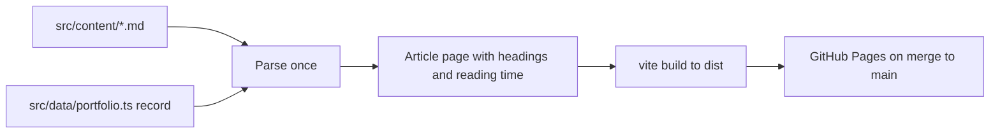

# CONCEPTS

The ideas behind this repo, in the order you meet them.

## The site is a static index over Markdown evidence

Every article is a Markdown file in `src/content/`. A record in `src/data/portfolio.ts` registers it with a title, a date and a summary. The site reads the Markdown once, takes the headings and reading time from that single parse (ADR-042), and renders the page. There is no server. GitHub Pages serves the build from `main`, so merging deploys.

## Three layers of the same claim

A reader meets each item at three depths. The `plain` sentence is for a skimming recruiter. It is 25 words or fewer and names the problem or the result. The `summary` carries the precise terms for a technical reader. The body and its "For engineers" part carry the full detail. The depth is never cut to fit the plain sentence. See `CLAUDE.md` for the copy rules.

## A number must be earned

A result appears only if it is on the published résumé or the author confirmed it. Each note ends with what it does not show. That list is part of the result, not an apology.

## System 1 and System 2, narrowly

System 2 is the slow general model that writes the answer. System 1 is a fast model that picks one label from a closed list. The RAG Mini note puts a System 1 guard and router in front of Gemini. The guard fails closed, so a failure refuses the request. The consequence is that a refusal path with no dependency on the big model keeps working when the big model is down.

## Decisions are written down

`adr.md` records each decision with its context, the rejected alternatives and how to undo it. Design docs (`architecture.md`, `logic_flow.md`, `api.md`) are updated in place, never copied.
