# Architecture Decision Record

## ADR-001: Curated index instead of single-page resume

**Status:** Accepted

**Decision:** Make the homepage a small editorial index and move depth into routed detail pages.

**Why:** The current page demonstrates breadth but forces every audience through the same long sequence. Separate pages allow recruiters to scan and technical readers to inspect evidence.

**Trade-off:** More routes and content maintenance, but clearer hierarchy and stronger shareable URLs.

## ADR-002: Meaningful activity ledger instead of contribution heatmap

**Status:** Accepted

**Decision:** Display dated public outputs and milestones. Do not display raw commit totals or a cloned GitHub heatmap in the first release.

**Why:** Commit frequency measures repository activity, not research or engineering value. A curated ledger can explain what changed and link to the artifact.

**Trade-off:** Updates are initially manual. This is intentional: editorial judgment is part of the signal.

## ADR-003: Local typed content as source of truth

**Status:** Accepted

**Decision:** Store work, publications, and activity as typed TypeScript records in the repository.

**Why:** The site is currently a static Vite application. Local typed content preserves simple deployment, version history, and compile-time validation without introducing a CMS or database.

**Trade-off:** Publishing requires a code change. A CMS can be reconsidered after publishing frequency proves the need.

## ADR-004: Honest publication taxonomy

**Status:** Accepted

**Decision:** Separate `writing`, `note`, `research`, `reproduction`, and `paper`, and attach explicit statuses such as `draft`, `published`, `submitted`, `under-review`, or `accepted`.

**Why:** A technical note is useful evidence but must not be presented as peer-reviewed research.

**Trade-off:** More metadata and stricter wording, with materially higher credibility.

## ADR-005: Evolve, do not clone, the reference design

**Status:** Accepted

**Decision:** Borrow the reference site's calm navigation and public-work hierarchy without reproducing its visual identity.

**Why:** Saketh's strongest differentiation is production AI systems moving toward industrial machines and compute. The design should express that specific story.

**Trade-off:** Less immediately flashy than the current hero, but more distinctive and readable.

## ADR-006: Build-time or manual GitHub integration only

**Status:** Accepted

**Decision:** Do not call GitHub APIs from the browser for the initial version. Public GitHub releases may later be ingested during the build and converted into reviewed activity records.

**Why:** Client-side API calls add loading states, rate-limit failure, and uncurated noise.

**Trade-off:** No automatic real-time activity initially.

## ADR-007: Hash routing remains for the first redesign

**Status:** Superseded by ADR-047 (2026-11-19).

**Decision:** Keep the existing `HashRouter` during the first implementation unless the deployment target is changed and configured for SPA rewrites.

**Why:** This minimizes deployment risk while enabling detail pages.

**Trade-off:** URLs contain `#`. Clean URLs can be a later deployment decision.

## ADR-008: Full experience chronology gets its own route

**Status:** Accepted

**Decision:** Add `/#/experience` for the complete reverse-chronological work history. The homepage contains only a compact preview and a resume action.

**Why:** Recruiters need the chronology, but placing every bullet on the homepage would recreate the long-resume problem the redesign is solving.

**Trade-off:** One additional click for complete detail, in exchange for a much faster homepage scan.

## ADR-009: LinkedIn establishes chronology; the approved resume establishes technical emphasis

**Status:** Accepted

**Decision:** Use the supplied LinkedIn screenshots for company, title, employment type, dates, location, and ordering. Use the approved resume for the tighter J&J, HP, and ECrent achievement bullets. Feature only the résumé roles (J&J, HP, ECrent) in the timeline. List every role, including iDwTeam and ASU, as one-line rows in a "Full history" section at the bottom, like LinkedIn. Given up: iDwTeam and ASU get no summary or bullets on the portfolio, and the page carries two views of the same roles.

**Why:** LinkedIn is the complete employment ledger, while the resume contains stronger recruiter-facing technical framing. Combining them prevents both missing roles and bloated copy.

**Trade-off:** The site intentionally does not reproduce every LinkedIn bullet verbatim.

## ADR-010: Neural animation is progressive enhancement

**Status:** Accepted

**Decision:** Represent the chronology as connected neural nodes with a subtle signal animation, ordered newest to oldest. Content remains ordinary semantic HTML and fully visible without JavaScript animation.

**Why:** The visual metaphor supports the AI-systems identity while chronology—not spectacle—remains the primary information.

**Trade-off:** Requires careful mobile and reduced-motion testing.

## ADR-011: Resume is a first-class recruiter action

**Status:** Accepted

**Decision:** Keep one canonical PDF in `public/`, label the action `Download resume`, and expose it from the hero, Experience route, and footer.

**Why:** Recruiters should not need to search the site or copy experience manually.

**Trade-off:** The checked-in PDF must be refreshed whenever the approved resume baseline changes.

## ADR-012: Contact returns as the homepage's closing section, not a route

**Status:** Proposed

**Decision:** Add a contact section as the final block of the homepage, after the activity ledger. Do not add a `/#/contact` route, and do not add `Contact` to the primary navigation.

**Why:** ADR-001 made the homepage a curated index that a recruiter reads top to bottom in about thirty seconds. A narrative that ends on a list of recent activity ends on an observation; ending it on a contact block ends it on an action, at exactly the point where a convinced reader is looking for one. A dedicated route would put a click between that moment and the address, and would spend one of six navigation slots on a section containing four links — slots currently held by Work, Experience, Writing, Research, and Notes, all of which hold substantially more.

The information architecture in `architecture.md` has listed `Contact / resume` as the last homepage node since before the redesign. This restores what was already specified rather than introducing a new idea.

**Trade-off:** There is no shareable contact URL, and the section is reachable only by scrolling the homepage or by using the footer's icons. If the site later grows a "work with me" or availability page with real content, that becomes a route and this ADR gets superseded.

## ADR-013: The email address is page text; `mailto:` is an enhancement on top of it

**Status:** Proposed

**Decision:** Render `sakethv7@gmail.com` as visible text. Wrap it in a `mailto:` link and add a copy-to-clipboard control beside it. Never rely on the `mailto:` alone to communicate the address.

**Why:** A `mailto:` link is a request that the operating system open a registered mail handler. When none is registered — a browser-only mail setup, a locked-down corporate machine — the click does nothing and reports nothing. No error, no navigation, no console output. This is the current bug: the site's single most important action fails silently and undetectably, and it fails for exactly the audience most likely to be on a managed laptop.

Making the address readable text removes the dependency. The worst outcome becomes a visitor reading eleven characters and typing them elsewhere, which always works. The `mailto:` still serves everyone whose machine handles it, and the copy button serves the middle case where a visitor wants the address in a different tool.

The clipboard write itself uses the async Clipboard API, which requires a secure context and can be denied. That failure must be visible — the address stays on screen regardless, so a denied copy degrades to the always-works path rather than to nothing.

**Trade-off:** A plaintext address on a public page is harvestable by scrapers, so this accepts some spam risk in exchange for the contact path actually working. Obfuscation schemes that defeat scrapers also defeat screen readers and copy-paste, which costs more than the spam does. The section also gains a small amount of client state and an interaction to test, where a plain link had none.

## ADR-014: Every URL pointing at this site is router-aware or base-path-composed

**Status:** Proposed

**Decision:** Replace the not-found page's raw `href="/"` with router navigation, add a base-path-composed favicon link, and add `og:image` and `og:url` built from the deployed origin. Prohibit raw absolute paths that point back at this site.

**Why:** The site is served from `/sakethai-portfoliogen/`, not from the domain root. A path written as `/` or `/favicon.ico` resolves correctly in local development, where the Vite base is `/`, and incorrectly in production, where it escapes to the domain root. The bug class is invisible to the build, to TypeScript, and to local testing — it appears only after deploy, which is where it is most expensive to notice.

Three instances exist today. The not-found page's home link leaves the site. The missing favicon link causes the browser to probe the domain root and get nothing, so the deployed `public/favicon.ico` is never requested. And `twitter:card` is declared as `summary_large_image` with no image to display, so every shared link renders an empty card — the portfolio's primary distribution channel is a pasted URL, which makes this the most visible of the three.

The not-found page is also restyled into `PortfolioShell`. It currently ships Tailwind's `bg-gray-100` against a near-white `--foreground`, which renders its `404` heading invisible against its own background.

**Trade-off:** `og:image` requires producing and maintaining a social card image, which is a design asset that did not previously exist and that goes stale when the positioning copy changes. `og:url` must be hardcoded to the deployed origin because static HTML cannot compose it at request time, so it needs a manual edit if the site ever moves to a custom domain.

## ADR-015: "Stunning" comes from composition and type, not effects

**Status:** Proposed. Amends the *Visual system* section of `architecture.md`; does not supersede ADR-005.

**Context:** The goal is to move the site from "decent" to "memorable". There are two ways to get there. *Effect-led* design adds visual events: WebGL or particle heroes, glassmorphism, parallax, scroll-jacking. *Composition-led* design changes structure: tile hierarchy, a real display typeface, a disciplined scale, and one signature interaction. The pre-redesign site was effect-led, and ADR-005 removed it on purpose.

**Options:**

1. Effect-led redesign. High initial impact. Conflicts with ADR-005 and ADR-010, and costs 50–200 kB of JS plus ongoing GPU work.
2. Composition-led upgrade (bento fold, tokens, spotlight, restrained motion).
3. Typography and spacing polish only. The cheapest option, but it leaves the fold without evidence.

**Choice:** Option 2.

**Why:** The audience is recruiters and engineers. For them, the memorable moment is seeing real evidence (140k users, current role, flagship systems) arranged with obvious care in the first viewport. Effects are memorable once and then get in the way of reading. Composition also scales down to mobile, where most effect-led heroes collapse into a slow blank screen.

**Given up:** The "wow in the first 500 ms" that a motion-heavy hero gives. Visitors who judge by spectacle will find this quieter than template portfolios. It also closes off the WebGL/3D direction unless a later ADR reopens it.

## ADR-016: CSS-first motion; no Framer Motion or GSAP

**Status:** Proposed

**Context:** The requested micro-interactions are staggered entrance, scroll reveal, hover spotlight, and arrow nudges. The candidates are Framer Motion (now `motion`), GSAP with ScrollTrigger, or plain CSS plus one small hook.

**Options:**

| Option | Approx. cost (gzip) | Gives you |
|---|---|---|
| `motion` with `LazyMotion` + `domAnimation` | ~15–20 kB | Springs, exit animations, layout/shared-element transitions |
| GSAP core + ScrollTrigger | ~35 kB | Timelines, precise scroll scrubbing, pinning |
| CSS keyframes + `animation-timeline: view()` + one pointer hook | ~0.5 kB | Everything in the proposed motion table |

**Choice:** CSS, plus one ~15-line `useSpotlight` hook.

**Why:** Nothing in the proposed motion needs springs, exit choreography, or timeline scrubbing. Those are the features that justify a library. CSS also inherits `prefers-reduced-motion` handling from one media query, where a library needs it wired into every call. Size figures are approximate and should be re-measured if this is reconsidered.

**Given up:** Spring physics, which feels more "alive" than easing curves. Layout animations, e.g. a bento tile expanding into a detail page. Route exit animations. Scroll reveal in browsers without scroll-driven animation support: in Firefox, check support at implementation time. Those visitors see content with no reveal. That is the correct fallback, but they get a flatter experience. If detail pages later want tile-to-page morphing, adopt `motion` then, in a new ADR.

## ADR-017: The bento grid consolidates existing homepage blocks; it adds no content

**Status:** Proposed

**Context:** The homepage content budget in `architecture.md` limits the hero, selected work, and experience preview. A bento grid tempts you to fill tiles with filler: skills clouds, GitHub stats, tech logos.

**Choice:** The bento replaces the hero, the experience preview, and the featured-work grid. Every tile renders a record that already exists in `src/data/`. The one numeric tile uses the resume-backed "~140,000 internal users" figure and labels it approximate. Tiles are placed with `grid-template-areas`, and the DOM order is the reading order.

**Why:** It keeps ADR-001 and ADR-004 intact. The layout changes; the honesty rules don't. Tying tiles to data records also means a new flagship project changes the fold without layout code changes.

**Given up:** The generous editorial whitespace of the current hero. The name gets a smaller cell than the full-width `h1` it has now. Also, the fold is denser, which some readers find busier.

## ADR-018: Design tokens as CSS custom properties

**Status:** Proposed

**Context:** `index.css` has 30+ font sizes and 20+ spacing values with no system. Tailwind's theme is configured, but the live pages use none of its utilities.

**Options:** (1) Move the styling to Tailwind utilities and use its theme scale. (2) Keep the hand-written CSS and add a token layer of CSS custom properties.

**Choice:** Option 2. A type scale (ratio ≈ 1.25, 8 steps with `clamp()` on the top three), an 8-point spacing scale (4 → 128 px), radius and motion tokens in `src/styles/tokens.css`.

**Why:** Rewriting 190 lines of working semantic CSS into utility classes is a large, low-value diff. Tokens give the consistency benefit without changing the authoring model. Custom properties can also be read and animated at runtime, which the spotlight needs.

**Given up:** Tailwind's IntelliSense and constraint-by-construction. Nothing stops someone writing `margin: 37px` in plain CSS. Discipline replaces tooling.

## ADR-019: One signature interaction — the tile spotlight

**Status:** Proposed

**Context:** A portfolio feels designed when one interaction is distinctive and everything else is quiet. Several competing hover effects read as a template.

**Choice:** On pointer devices, each bento tile shows a soft radial glow in `--primary` at low opacity that follows the cursor, and the tile border brightens near the pointer. It is implemented as a single delegated `pointermove` listener on the grid. The listener writes `--mx`/`--my` to the hovered tile, and CSS paints a `radial-gradient` on a `::before` layer.

**Why:** It extends the site's "neural signal" metaphor (ADR-010): attention lights up the node it touches. It is cheap because the gradient layer changes only through a custom property, and it degrades to nothing on touch devices via `@media (hover: hover)`.

**Given up:** `background` repaints of one tile layer while the pointer moves. This is bounded to the hovered tile and throttled by the browser's frame rate, but it is not compositor-only like the other motion. Touch users never see the signature at all.

## ADR-020: Performance cleanup ships with the visual upgrade, not after it

**Status:** Proposed

**Context:** `architecture.md` deferred removing dead modules and unused providers to "a separate, explicitly requested pass". The measurements taken for this proposal show they are the largest performance items on the site.

**Choice:** Do it as phase 0 of the upgrade. Remove `QueryClientProvider`, `TooltipProvider`, `Toaster`, and `Sonner` from `App.tsx`. Delete the 13 pre-redesign components, `App.css`, `use-mobile.tsx`, and the unused `ui/*` primitives (verified unreachable by an import graph check before deletion). Remove the unused font family and dead theme tokens. Adopt the budget table in `architecture.md` as an invariant.

**Why:** Measured effect: entry JS 107.3 → 61.8 kB gz, CSS 14.0 → 4.8 kB gz. Doing it first also means the new CSS lands in a stylesheet that isn't mostly dead utilities, so the size of the upgrade itself can be measured honestly.

**Given up:** The pre-redesign components as a fallback you can copy from. They remain in git history, not in the tree. It also makes the diff larger in file count, so review phase 0 and the visual phases as separate commits.

## ADR-021: Embed the résumé on a `/#/resume` route with the browser's native PDF viewer

**Status:** Proposed

**Context:** The résumé is currently only a download link. Recruiters on desktop often want to glance at it without a file landing in their Downloads folder. Browsers differ sharply in inline PDF support. Desktop Chrome, Edge, Firefox, and Safari render PDFs natively. Android Chrome does not render inline PDFs at all. iOS Safari renders them inconsistently inside an embed.

**Options:**

| Option | Cost | Mobile |
|---|---|---|
| `<object type="application/pdf">` with a fallback | ~0 kB | Fallback content shows where unsupported |
| PDF.js (`pdfjs-dist`) canvas rendering | ~300 kB+ worker, lazy-loadable | Works everywhere |
| Pre-rendered PNG of the page plus a download link | One image, rebuilt with each résumé | Works everywhere, but text is not selectable and links are not clickable |

**Choice:** `<object>` on desktop-width viewports. Below 768px, show a short card with "Open PDF" (new tab, so the OS viewer handles it) and "Download" instead of the embed.

**Why:** It adds no dependency and keeps the PDF's own clickable links. The browsers that fail are exactly the ones where an in-page 8.5×11 frame is unreadable anyway, and opening in a new tab uses their full-screen viewer.

**Given up:** A consistent look across browsers. Each browser's viewer chrome differs, and the embed can't be themed to match the dark site. Mobile visitors don't get an in-page preview.

## ADR-022: Recruiter pass — show evidence, hide empty surfaces

**Context:** A recruiter-eye review on 2026-09-22 found that two of three flagship cards were private, three of six nav tabs held only planned or empty content, recent activity led with non-engineering projects, the "Current thesis" line claimed industrial and edge work the site did not evidence, and the portfolio's experience bullets were weaker than the résumé's.

**Options:** Leave the "building in public" framing as is; merge Writing, Research, and Notes into one tab; or hide them until content exists. For flagships: keep Lekhni, or promote SDLC Intelligence Agent or RoastRank.

**Decision:** Flagships are Enterprise AI quality, SakethWiki, and RoastRank (it has a live demo; the home card now renders demo links). Lekhni moves to Developer tools. Writing, Research, and Notes leave the primary nav and the home page; their routes and `publications` data stay so they can return with the first post. The thesis line is relabelled "Where I'm heading". Activity drops the poetry and Sanskrit entries, which remain under Creative builds. Experience bullets match the canonical base résumé, which is the same PDF the site serves.

**Given up:** Visible evidence of a writing practice, the "planned work shown honestly" signal, Lekhni's place on the home page, and a fuller activity list (two items remain). Portfolio copy must now be kept in sync with the base résumé by hand.

## ADR-023: Long-form pages are Markdown files rendered with `marked` in a lazy route chunk

**Context:** The site needs its first long pages, a case study and a post. Content today is short strings in `portfolio.ts`. Long prose needs headings, lists, links, and code, and Saketh needs to be able to write it without touching JSX.

**Options:**

| Option | Authoring | Cost | Risk |
|---|---|---|---|
| One TSX component per article | Prose inside JSX | 0 kB | Writing means editing code; easy to break |
| Typed block arrays in `portfolio.ts` | Awkward (`{type:'p', text:…}`) | 0 kB | Unpleasant to write anything long |
| Markdown + `react-markdown` | Plain Markdown | ~35–45 kB gz | Heaviest; plugin ecosystem not needed |
| Markdown + `marked` | Plain Markdown | ~12 kB gz | Outputs an HTML string, inserted with `dangerouslySetInnerHTML` |

**Decision:** Markdown files in `src/content/`, rendered with `marked` inside the lazily loaded `Article` page. The Markdown is loaded through `import.meta.glob(..., { query: '?raw' })` so each article is its own chunk.

**Why:** Markdown is how Saketh already writes (SakethWiki, Obsidian). `marked` is the smallest renderer that handles the full syntax, and loading it only on article routes keeps it out of the homepage bundle entirely. Inserting an HTML string is normally an XSS risk, meaning a way for someone else's text to run as code in the page. Here every Markdown file is written by Saketh and committed to the repo, so the input is trusted.

**Given up:** A new runtime dependency (the first since the cleanup work). Protection against untrusted Markdown: if content ever comes from anywhere other than this repo, a sanitizer such as DOMPurify must be added first. React components inside articles (MDX) are not possible with this choice.

## ADR-024: The portfolio is the canonical home for posts; LinkedIn carries the reach

**Context:** The first post needs a home. The candidates are the portfolio, a LinkedIn article, Medium or dev.to, or a Substack.

**Options:** Publish only on LinkedIn (most reach, no site traffic). Publish on Medium (discoverable, but the reader never sees the résumé or projects). Publish on the portfolio and share a LinkedIn post linking to it.

**Decision:** The portfolio holds the canonical copy. A short LinkedIn post, not a LinkedIn article, summarizes the argument and links to it. Cross-posting elsewhere is optional and must name the portfolio URL as canonical.

**Why:** A recruiter who finishes the post on the portfolio is one click from the case study, projects, and résumé. On LinkedIn or Medium they are one click from someone else's content. The portfolio also can't be deprecated or paywalled out from under the post.

**Given up:** Reach. LinkedIn's feed favors posts that keep readers on LinkedIn, so a post with an outbound link travels less far than a native article. The link preview will show the homepage card, not the article (HashRouter, see architecture open questions). The portfolio has no comments, subscriptions, or analytics.

## ADR-025: Lead with a plain sentence; keep the technical summary one step lower

### Visual Level

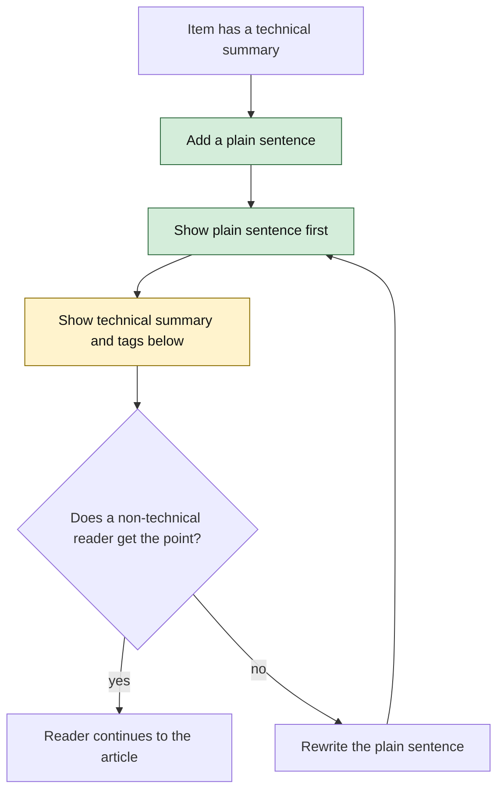

*Caption: green is new (the plain sentence and its position). Amber is changed (the technical summary moves down but stays). The loop at the bottom is the failure path: if the sentence does not land, rewrite it.*

**Context:** On 2026-10-05 Saketh reported that the portfolio is "too much keywords and literal" and gives a non-technical reader no reason to continue. The review confirmed it. Card summaries, the hero, and the link preview are keyword lists. The articles behind them open with stories and are good. Recruiters, the first readers, often are not engineers.

**Options:**

| Option | What the reader sees | Risk |
|---|---|---|
| A. Plain sentence first, technical summary below | Both, in order | Cards get taller |
| B. Replace the technical summary with plain text | Plain only | Engineers lose the signal that the work is real |
| C. A "simple / technical" toggle | One of two views | Needs state and a toggle that most visitors never use. Doubles the copy to maintain |
| D. Separate pages per audience | Two sites | Doubles everything. Splits traffic |

**Decision:** Option A. Each card, list row, and article header shows `plain` first. The existing summary and tags follow under a small "For engineers" label. Both stay visible. Nothing is collapsed.

**Why:** Both audiences read the same page, in an order that fits each. The non-technical reader stops after the first sentence and has the point. The technical reader reads on and finds specifics. A toggle hides content behind a click that few visitors make. Collapsing the technical part would hide it from the skimming engineer who has 10 seconds.

**Given up:** Card height. Each card grows by about two lines, so the Work archive scrolls longer. Also, one more field per item to keep honest. Two descriptions of one item can disagree, which is a risk the single-field flow in `architecture.md` limits but does not remove.

**Explainer ladder:** Levels 3 (HTML explainer) and 4 (video) are skipped. The change has no flow over time. It is a reordering of text on static pages. Level 1 (this text) and level 2 (the chart) are present.

## ADR-026: `plain` is a required field on every work item and publication

### Visual Level

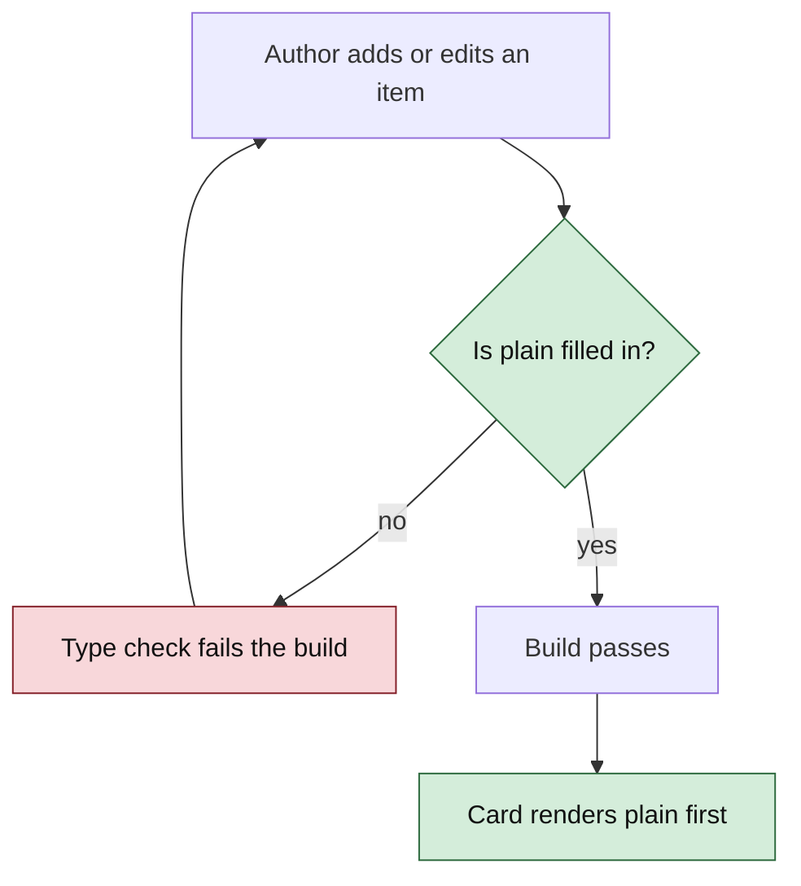

*Caption: green is the new check. Red is the failure path. A missing sentence stops the build, so a card cannot ship with no plain line.*

**Context:** The approved plan on 2026-10-05 said `plain` would be required for featured and published items and optional elsewhere. Optional means a fallback branch in every component: show `plain` if present, else show the summary. The result is a half-converted site where some rows lead with plain text and others with keywords.

**Options:** (1) Required on both types. (2) Optional, with a fallback to `summary`. (3) Required for featured and published only, as first planned.

**Decision:** Option 1. This differs from the sentence in the approved plan. The reason is that all 22 work items and 15 notes get a sentence in this change anyway, so the fallback has no case to serve. The TypeScript compiler enforces the rule for free.

**Why:** No fallback code means nothing to test and nothing to forget. A future item cannot ship with keywords only.

**Given up:** Speed of adding a quick item. Every new project needs one sentence before it appears, even a minor one. That is the intended friction. Also a small departure from the plan Saketh approved. If that is not acceptable, option 3 is a one-line type change.

**Explainer ladder:** Levels 3 and 4 skipped. This is a type rule with no flow over time.

## ADR-027: Remove industrial-machine and edge-compute claims from the hero, meta tags, and contact line

### Visual Level

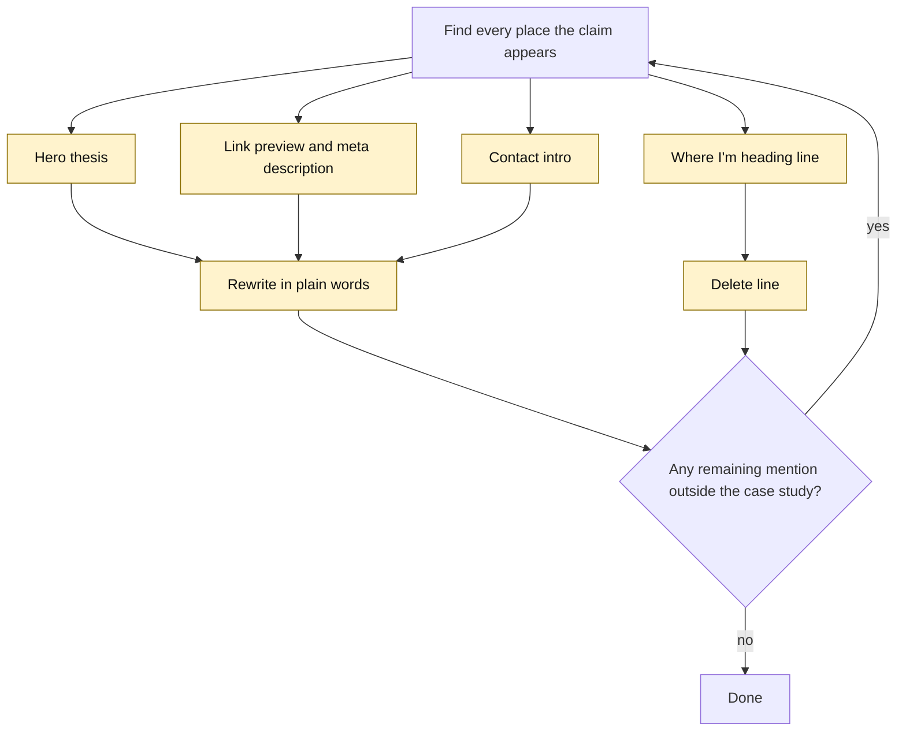

*Caption: amber marks every changed surface. The claim appears in four places, one of them the link preview, which is the first thing a recruiter sees when the URL is shared. The loop is the check that none remain.*

**Context:** ADR-022 found that the thesis line claimed industrial and edge work the site did not evidence, and relabelled it "Where I'm heading" instead of removing it. Saketh's operating rule is to keep FactoryMind and industrial direction off application materials by default. On 2026-10-05 Saketh confirmed: drop it. A grep found four surfaces: `Index.tsx` lines 14 and 22, `index.html` `og:description`, and `ContactSection.tsx` line 32.

**Options:** Keep it as a "future direction" line; remove it from the hero only; remove it everywhere except the case study.

**Decision:** Remove it from the hero, the "Where I'm heading" line, the meta and link-preview text, and the contact line. It stays in the agentic-maintenance Work row and build log, where it is the subject and is labelled as unproven. (Wording corrected 2026-10-05: the first draft said "everywhere except the build log", which would have removed the project's own description.)

**Why:** A claim a recruiter cannot verify costs more trust than it earns. The hero should carry only what the site proves. The link preview matters most, because it is read before the page loads.

**Given up:** The signal of where Saketh wants to go next. Roles in industrial AI will not see that interest on the first screen. They can still find it in the Work archive. This amends ADR-022.

**Explainer ladder:** Levels 3 and 4 skipped. A text removal has no flow over time.

## ADR-028: Copy is accepted by a human 10-second test, not by a linter

### Visual Level

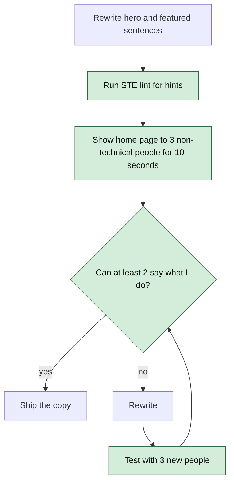

*Caption: green is the new acceptance step. The failure path loops back to a rewrite and a new test group. A linter can pass bad copy. Only a reader can fail it.*

**Context:** "Clear to non-technical readers" cannot be checked by a tool. `ste-lint.py` finds long sentences and banned words. It cannot tell whether a sentence means anything to someone outside the field.

**Options:** (1) Lint only. (2) Self-review only. (3) Lint for hints, then a 3-person, 10-second test with a fixed pass mark.

**Decision:** Option 3. The pass mark is that at least 2 of 3 people can say, in their own words, what Saketh does. A failed round needs three new people. This is the falsifier: if copy that passes the lint fails with people, the people win.

**Why:** The goal is reader understanding. Only readers measure it. Naming the pass mark in advance stops the test from bending to fit the copy. The same people cannot be reused, because they would remember the earlier version.

**Given up:** Time and some social effort, about 30 minutes plus finding the readers. Also statistical strength. Three people is a smoke test, not evidence. It catches gross failure, not subtle differences. That is the right size for a personal site.

**Explainer ladder:** Levels 3 and 4 skipped. A test procedure has no flow over time that a viewer needs to see.

## ADR-029: Curate the homepage around distinct systems capabilities

**Status:** Proposed

**Decision:** Feature SakethWiki, Lekhni, and the SDLC Intelligence Agent. Keep RoastRank in the Work archive.

**Why:** The cards then demonstrate knowledge systems, local-first ingestion, and event-driven developer workflow. RoastRank remains useful evaluation evidence, but overlaps more with the enterprise evaluation story.

**Trade-off:** The homepage loses a public demo link and gains a clearer systems narrative.

## ADR-030: Mark evidence status explicitly

**Status:** Proposed

**Decision:** Add `Production / enterprise`, `Public prototype`, `Private prototype`, or `Experimental / public-data validation` to homepage selections and Experience case-study previews.

**Invariant:** A status must not imply a deployment, customer, metric, or platform implementation that the linked artifact cannot support.

## ADR-031: Put three proof cards beside the hero claim

**Status:** Proposed (2026-10-27)

### Visual Level

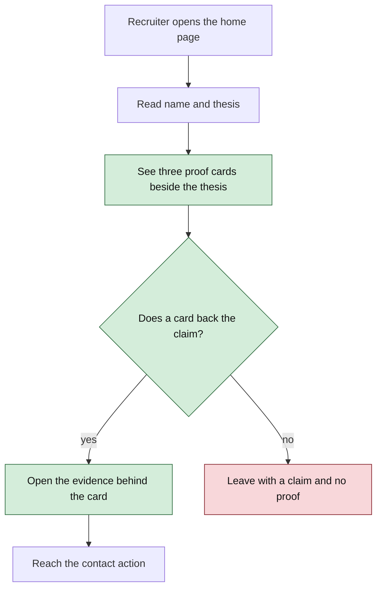

*Caption: green is new. Today the first screen holds a claim only, so every reader takes the red path. The cards give the claim proof that a reader can open.*

**Context:** On 2026-10-27 Saketh compared the site with kavitaayein.com. That site puts each claim next to its proof in the first viewport. For example, "2.4M impressions" sits beside a screenshot and links to the full story. Our hero says "a system used by about 140,000 employees" in plain text. The proof for that claim is one or two clicks away. The architecture diagnosis from 2026-09-22 found the same gap: "The first viewport shows no evidence."

**Options:**

| Option | What the reader sees | Cost | Risk |
|---|---|---|---|
| A. Three text proof cards beside the thesis | Claim, one evidence line, one link per card | One small data module, CSS | Less visual punch than a screenshot |
| B. Screenshot proof cards, as on the reference site | Real dashboards or charts | Image assets to keep current | Internal screenshots break the confidentiality rule. Public screenshots are weak. |
| C. The full bento fold from ADR-017 | Nine tiles in one grid | Large layout rewrite plus tokens | Large change. ADR-017 has stayed Proposed since 2026-09-22. |
| D. No change | Claim only | None | The gap stays |

**Choice:** Option A.

**Why:** The goal is "proof next to the claim." Text cards do that at the smallest cost. Option B fails on the employer work, because screenshots of the production system cannot go on a public page. Option C solves the same problem but also changes the whole fold, the type scale, and the motion. That is more change than this problem needs. Option A is a subset of C, so C stays possible later.

**Given up:**

1. The visual weight of real images on the employer work. Cards 1 and 2 stay text only, and a text card is easier to skip than a chart. Card 3 can show a screenshot, because SakethWiki is Saketh's own app (ADR-032).
2. Hero simplicity. The first viewport gets denser, and the thesis loses half its width on desktop.
3. A cleaner decision record. If Saketh approves this ADR, ADR-017's hero part is partly superseded. See the open questions in `architecture.md`.

**Explainer ladder:** Levels 3 (HTML explainer) and 4 (video) are skipped. The change is a static layout. It has no flow over time. Levels 1 and 2 are present.

## ADR-032: Proof cards come from data records, and the cards show only confirmed numbers

**Status:** Proposed (2026-10-27)

### Visual Level

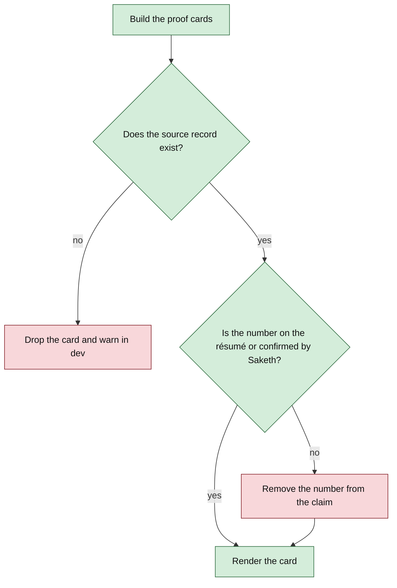

*Caption: green is the new build path. Red marks the two failure paths. A missing record drops the card. An unconfirmed number leaves the claim but loses the number. Neither path shows a placeholder.*

**Context:** A proof card makes a strong claim in a small space. Two things can make it false. A typed count can go stale when a note is added. A card can point at a record that was renamed or removed. Copy rule 3 in `CLAUDE.md` also limits numbers to the résumé or to results that Saketh confirmed.

**Options:**

1. Hand-written cards in `Index.tsx`.
2. Cards built in a small data module from existing records (`experiences`, `publications`, `work`). The module derives counts and links.
3. A new `proof` field on each record, with a query that picks the top three.

**Choice:** Option 2. The proposed cards:

| # | Claim | Evidence line | Link | Source |
|---|---|---|---|---|
| 1 | I work on evals, observability, red-teaming, guardrails, and data and vector schemas for a production RAG platform | The platform serves about 140,000 employees | Read the case study → `/experience/enterprise-ai-quality` | `experiences` record with `caseStudy`. The number is on the résumé. |
| 2 | {N} engineering notes on evaluation, retrieval, and tracing | Newest: {title of the latest Published note} | Read the notes → `/writing` | `publications` with status `Published`. N is counted, not typed. |
| 3 | A knowledge app I use daily: capture, chat, review, browse | SakethWiki, public prototype | See the code ↗ (GitHub) | `work` record `sakethwiki`, field `github`. The card shows one screenshot of the app. |

**Why:** Option 1 lets a count drift from the data. Option 3 adds a field to every record for three cards, which is more structure than the need. Option 2 keeps one source of truth and stays small. Card 2 counts the notes, so it updates when a note ships.

Card 3 changed from RoastRank to SakethWiki on 2026-10-27, at Saketh's call. SakethWiki is a full application with five surfaces: Capture, Chat, Revise, Browse, and Dashboard. RoastRank is one evaluation service. A screenshot of SakethWiki shows a working product in one glance, which is the reference site's strongest move. It is Saketh's own app, so the confidentiality rule does not block the image. This makes card 3 the only card with an image (see ADR-031, given up item 1).

Card 1's claim covers the build scope Saketh listed on 2026-10-27. The full list goes in the case study, not on the card. See the open questions in `architecture.md`.

**Given up:**

1. The 10% self-service result on card 1. It is the strongest outcome, but its unit (relative gain or percentage points) is still unresolved. Card 1 shows scale only until Saketh resolves it.
2. A new data file to maintain (`src/data/proof.ts`), and one image asset that goes stale when the SakethWiki interface changes.
3. A live demo on the home page. SakethWiki runs locally and has no public demo, so card 3 links to code. RoastRank's demo stays in the Work archive.
4. Some freedom of wording. Card 1's claim stays hand-written, and its number has to match the résumé by hand.

**Explainer ladder:** Levels 3 and 4 skipped. This is a data rule with no flow over time.

## ADR-033: The hero has two distinct actions: "Get in touch" and "View résumé"

**Status:** Proposed (2026-10-27). Revised the same day after Saketh's review.

### Visual Level

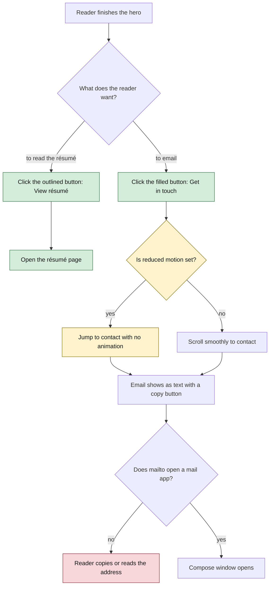

*Caption: green is new: two named actions, one per reader goal. Amber is changed: the scroll obeys reduced motion. Red is the mailto failure path. ADR-013 already covers it, because the address stays visible.*

**Context:** The hero shows four links of near-equal weight: "Explore the work" (styled as primary), "View résumé", "GitHub", and "Contact". A skimming reader cannot tell which action matters. The current "Contact" link also hardcodes `behavior: 'smooth'`, which ignores `prefers-reduced-motion`. The 2026-09-22 findings table records that bug.

The first draft of this ADR kept one button and made "View résumé" a plain link. On 2026-10-27 Saketh rejected that: the two actions serve different goals. "Get in touch" means email. "View résumé" means read the résumé. Neither one replaces the other.

**Options:**

| Option | Hero actions | Strength | Weakness |
|---|---|---|---|
| A. One button: Get in touch | Filled contact button, plain links for the rest | Clearest single next step | Hides the résumé goal behind a plain link |
| B. Two buttons with a visual order | Filled "Get in touch", outlined "View résumé", plain "GitHub" | Each goal has its own named button. The fill still shows which one comes first. | Two buttons compete more than one |
| C. Two equal buttons | Both filled | Neither goal ranks above the other | The reader gets no cue at all, which is today's problem |

**Choice:** Option B.

- "Get in touch" is a filled button. It scrolls to the contact section, where the email shows as text with a copy button. It does not open `mailto:` directly, because a direct `mailto:` fails with no message on machines with no mail app (ADR-013).
- "View résumé" is an outlined button. It opens `/resume`.
- "GitHub" stays a plain text link.
- "Explore the work" leaves the hero.
- The scroll uses `behavior: 'auto'` when the reader set reduced motion.

**Why:** A recruiter arrives with one of two goals: contact Saketh, or read the résumé first. Each goal gets a button that names it. The filled style still gives one visual first choice, so the hero does not go back to four equal links. The proof cards and the nav already lead into the work, so "Explore the work" is not needed in the hero.

**Given up:**

1. The single-button clarity of the reference site. Two buttons compete for the first click.
2. "Explore the work" leaves the hero. A reader who skips the proof cards has only the nav to reach the archive.
3. One extra step for email. "Get in touch" shows the address. It does not open a compose window. That step is the cost of a contact path that always works.

**Explainer ladder:** Levels 3 and 4 skipped. A button change and one scroll have no flow that a viewer needs to watch.

## ADR-034: One Writing page replaces the Writing and Research pages

**Status:** Proposed (2026-11-05). Waits for Saketh's review. Amends ADR-022 (nav rule) and ADR-004 (taxonomy, display only).

### Visual Level

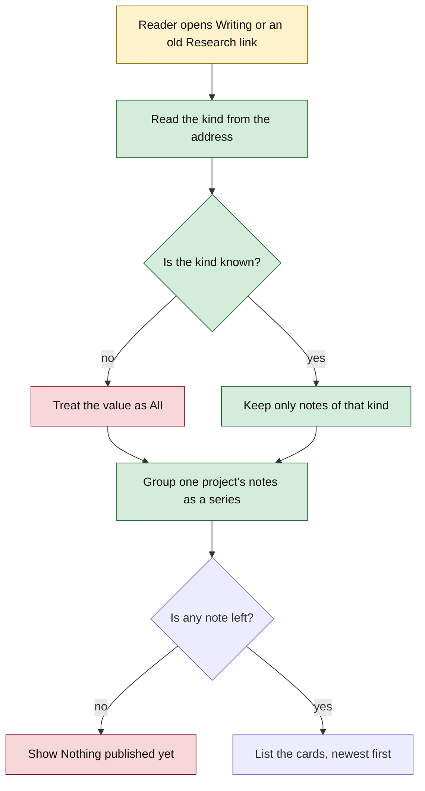

*Caption: green is new: a kind filter on one page. Amber is changed: the old Research link now lands here. Red is the failure path: an unknown kind or an empty result. Explainer with today's steps around the change: [adr-034-writing-one-page.html](docs/visuals/adr-034-writing-one-page.html).*

**Context:** The nav shows Work, Writing and Research. The same notes appear on all three. Work lists the notes under each project. Writing shows notes whose `kind` is not "Research note". Research shows the rest. Both pages use one component, `Collection.tsx`. The only difference is a filter on `kind`. A reader does not choose a page by that kind. They choose by project or by topic. Notes for one project already sit on the Work page.

**Options:**

| Option | Nav | Strength | Weakness |
|---|---|---|---|
| A. Keep three pages | Work, Writing, Research | No change | Same notes in three places. The Research split means little to a skimming reader. |
| B. Merge Writing and Research. Filter by kind. | Work, Writing | One list of notes. Kind stays visible as a chip. Work keeps the projects. | The Research label leaves the nav. |
| C. One Work page with Projects and Notes tabs | Work | One place, as first asked | Adds a tab level. Work already nests notes per project, so little duplication goes away. |

**Choice:** Option B. Saketh said "you decide" on 2026-11-05.

- `/writing` shows every published note. Chips filter by kind: All, Engineering, Research, System design, Build log.
- The chip is stored in the address as `?kind=`. A reader can link to a filtered view.
- A series card (one project's notes) appears in every view. Under a kind filter it lists only the chapters of that kind. It disappears if none match.
- `/research` redirects to `/writing?kind=research`. Old links keep working.
- The nav drops the Research link. Home keeps its Research block and links it to the filtered view.
- Work does not change.

**Why:** One list answers "what has he written". The kind stays as a label, so the research notes (which cite sources) stay easy to find. Work keeps one job: projects.

**Given up:**

1. A top-level "Research" label in the nav. A recruiter who looks for it must open Writing first.
2. One more click to see only research notes, unless they follow a link with `?kind=research`.
3. A small amount of code: a chip row, a query-string read, and a redirect route.

**Explainer ladder:** Levels 1, 2 and 3 are done. No video (see the no-narrated-videos rule).

## ADR-035: Home stops repeating the benchmark

**Status:** Proposed (2026-11-05). Waits for Saketh's review. Amends ADR-031 and ADR-032 (the writing card).

### Visual Level

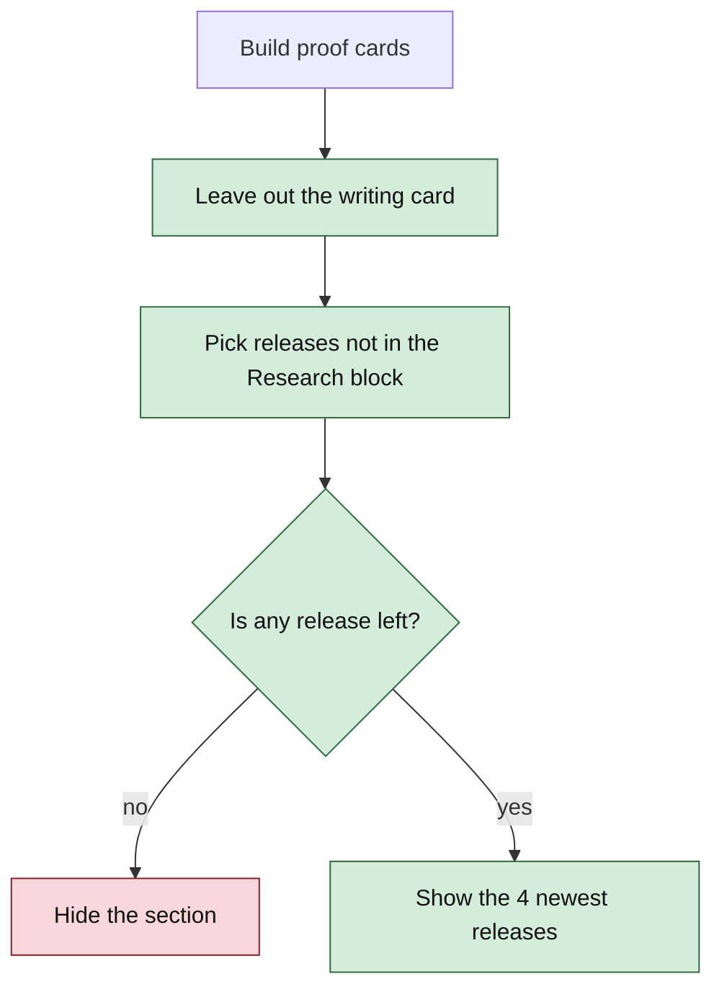

*Caption: green is new. Red is the failure path. Explainer with the steps of today around it: [adr-035-trim-home-and-work.html](docs/visuals/adr-035-trim-home-and-work.html).*

**Context:** The GEO benchmark shows four times on the home page: in a proof card, in the Selected work card, in the Research block, and in 4 of the 9 Recent activity entries. The J&J work shows once. A skimming reader sees one project and may think it is the only one. The "30 published notes" claim in the writing card counts 8 notes that belong to one project. The research card already says "8 notes". The code returns 4 proof cards, but ADR-032 says 3 or fewer.

**Options:**

| Option | Result | Weakness |
|---|---|---|
| A. Keep all | No change | The repeat stays |
| B. Show the 4 newest releases | Short list | All 4 newest are benchmark entries, so the repeat stays |
| C. Remove the writing card. Show the 4 newest releases that are not in the Research block. | 3 proof cards. The activity list shows Lekhni, SakethWiki and Job Tracker. | 5 entries leave the home page |
| D. Remove the Recent activity section | Shortest page | Loses the only view of the other projects |

**Choice:** Option C.

- Remove the `writing` proof card. `ProofCard['id']` loses `'writing'`.
- `ActivityItem` gets an optional `series` field, with the same value as `PublicationItem.series`. The four benchmark entries get `series: 'GEO agent benchmark'`.
- The home page shows the 4 newest entries whose `series` is not `'GEO agent benchmark'`. The section is hidden if none remain. The heading changes from "Recent releases" to "Also shipped".
- The "browse all 30 notes" text becomes "browse all notes". `noteCounts` keeps only the `research` field. The other fields have no reader left.

**Why:** The Research block already tells the benchmark story in full. The activity list then shows the rest of the work. This also restores the 3-card limit in ADR-032.

**Given up:**

1. The hero no longer links to the Writing page. The nav and the Research block still do.
2. The 4 benchmark release entries leave the home page. Their notes stay on Writing.
3. The `series` field is one more thing to set by hand on a new entry.

## ADR-036: The second hero paragraph is four short sentences

**Status:** Proposed (2026-11-05). Waits for Saketh's review.

### Visual Level

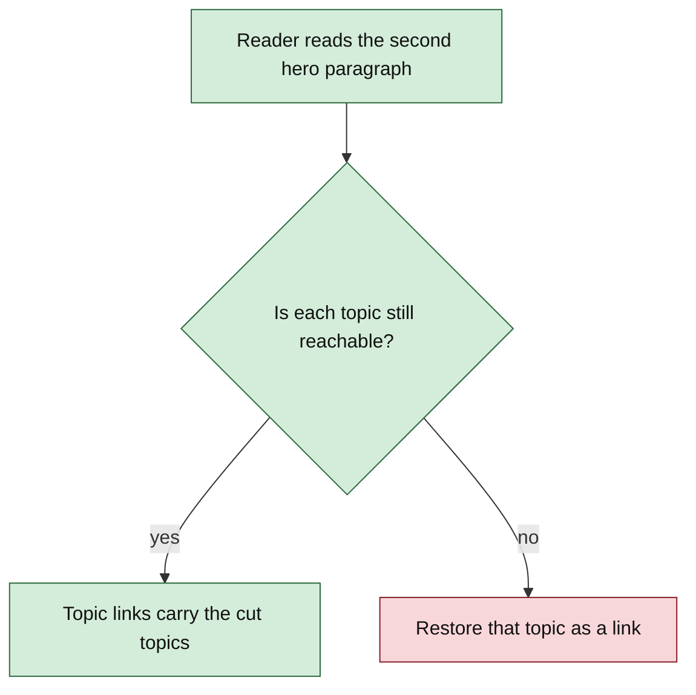

*Caption: green is the new text. Red is the check that no topic loses its path.*

**Context:** The second paragraph lists eight topics in about 95 words. The topic links below it already name the same topics. A reader who skims sees a list twice.

**Options:**

| Option | Words | Weakness |
|---|---|---|
| A. Keep | About 95 | The list repeats the links |
| B. Four sentences | About 55 | Names such as Lekhni and the SDLC agent leave the hero text |
| C. Delete the paragraph | 0 | Loses the "on my own time" framing and the chip readings Saketh asked for in a0ff77a |

**Choice:** Option B. Proposed text:

> On my own time, I test how AI systems behave and publish what I find. I benchmarked Ollama against MLX while reading chip power, heat and memory counters. I run my own test sites to study networking, DNS, web security and AI agent behavior. I am now learning hardware: ESP32, Arduino and robotics.

The first paragraph does not change.

**Why:** Each cut topic has a link: LLM judges, Pipelines, MCP, Small models. The chip readings stay, as commit a0ff77a chose. The sentences stay at 25 words or fewer.

**Given up:** Lekhni, the SDLC agent and MCP servers are no longer named in the hero text. A reader reaches them through the chips and the Selected work cards.

## ADR-037: The Work page header has no counts, and two groups fold

**Status:** Proposed (2026-11-05). Waits for Saketh's review.

### Visual Level

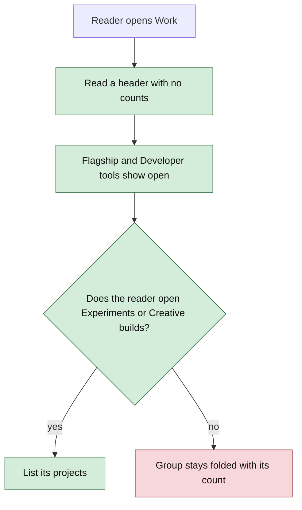

*Caption: green is new. Red is the cost: a folded group hides its projects until opened.*

**Context:** The header holds a count of projects and four note counts. The Writing page now owns the note counts. Of 22 projects, the Experiments and Creative builds groups hold 9. They are real work but not the first thing to read.

**Options:**

| Option | Result | Weakness |
|---|---|---|
| A. Keep | 22 projects open | The page is long |
| B. Fold two groups with `<details>`. Header without counts. | Two open groups and two closed | Folded projects are hidden at first |
| C. Remove the two groups | Shortest page | Deletes real work |

**Choice:** Option B. The header reads: "Production-facing systems, developer tools and experiments. Each entry says whether it is deployed work, a prototype or learning work. The notes on a project are listed with it." The `<details>` summary shows the group name and its count. No new dependency or script. The Flagship group is already first, so no re-sorting.

**Why:** `<details>` is native HTML. It needs no JavaScript. The count in the summary tells a reader what is inside.

**Given up:**

1. A reader who skims sees 13 projects first, not 22.
2. Find-in-page may not open a folded group in every browser. I will test Chrome and Safari before shipping. The result goes in this ADR.
3. The project and note counts leave the page header.

**Explainer ladder:** Levels 1, 2 and 3 are done for ADR-035, ADR-036 and ADR-037. One explainer covers all three. No video.

## ADR-038: Frame GEO-agent-bench as a behavior and security harness

**Status:** Accepted (2026-11-08).

**Context:** The portfolio described GEO-agent-bench mainly through formats such as `llms.txt`, the markdown interceptor and its token result. That made one Phase E observation look like the project's thesis. The implemented project is broader: it compares legacy, agent-readable and agent-native web surfaces while testing navigation, instruction adherence, data exposure, identity, OAuth and signed requests. Its evidence also comes from different client types. Qwen and Claude ran as agents in the harness; Anthropic and OpenAI crawlers appeared in public logs; OpenAI hosted search was a separate probe. Calling all of them crawlers or a three-agent comparison would be false. The interceptor returns a cleaner representation of a requested page; it is not yet a task-aware least-privilege filter.

**Choice:** Keep the project name, but call it a descriptive experimental harness and state that it is not yet a general benchmark of GEO effectiveness. Lead with the three web surfaces and the behavior/security questions. Keep the token reduction as one finding with its one-run-per-cell limit.

**Why:** This framing matches the implemented system and prevents a reader from generalizing the Phase E result beyond its evidence.

**Rejected alternatives:**

1. Lead with the two-thirds token reduction. Rejected because it describes one agent tool on one synthetic site with one run per cell.
2. Say Qwen, Claude and GPT were three crawlers or three comparable agents. Rejected because Qwen ran locally through the harness, while GPT evidence came from crawler traffic and a hosted-search probe.
3. Rename the repository. Rejected because the current name is established and the limitation can be made explicit in the description.

**Given up:** The short description is less promotional. It gains a more accurate account of what the project demonstrates.

## ADR-039: Translate the homepage into recruiter language without replacing the systems position

**Status:** Accepted (2026-11-08) after teach-back.

**Context:** The hero leads with “Applied AI Systems Engineer,” while the current role is Data Scientist and the target search includes data-science work. The homepage did not name the recruiter stack near the title. The compact experience list showed only dates, titles and companies even though the J&J record already contains approved public evidence. The activity list deliberately excludes GEO-agent-bench releases because the Research block owns them, but its “Recent activity” label made the October entries appear to be the newest work on the site.

**Decision:** Keep “Applied AI Systems Engineer” as the hero eyebrow. Add one supporting line naming data science, production AI evaluation and data systems, followed by Python, SQL, PySpark and AWS. For the current experience only, render the existing `caseStudy.plain` evidence; do not copy its metrics into the component. Rename the non-GEO activity block “Outside this research / Other work shipped.”

**Why:** The supporting line maps the systems position to common recruiter language without presenting three competing job titles. Reusing `caseStudy.plain` keeps the homepage and experience case study on one evidence source. The new activity label explains the section boundary instead of implying that October is the latest site activity.

**Rejected alternatives:**

1. Replace the headline with “Data Scientist / Data Engineer / AI Engineer.” Rejected because three titles weaken the positioning and imply equal evidence for each role.
2. Hard-code a shorter J&J metric sentence in `Index.tsx`. Rejected because it would create a second claim that could drift from the approved experience record.
3. Put GEO releases back into the activity list. Rejected because that would duplicate the Research block and reverse ADR-035.

**Failure and recovery:** A future current role without a case study shows no evidence line rather than inventing one. If the supporting line or evidence makes the hero or experience strip too dense, the change is recoverable by reverting this ADR's `Index.tsx` and CSS additions; it has no persistent or external write.

**Teach-back:** Saketh confirmed that “Applied AI Systems Engineer” expresses the end-to-end direction: proven AI and data-system work now, hardware fundamentals in progress, and eventual ownership of AI-enabled industrial products. Homepage evidence remains sourced from `caseStudy.plain`; a résumé-only metric is not copied automatically, and a missing case study produces no evidence line. The 390 px mobile render was reviewed. Both additions remain; if later copy makes the page too dense, the longer current-job evidence line is removed before the recruiter-facing role-and-stack line. GEO releases remain in Research instead of being duplicated under “Other work shipped.”

## ADR-040: Publish the e-means reproduction as bounded applied research

**Status:** Accepted by explicit teach-back waiver (2026-11-14).

**Context:** The completed e-means experiment has a defensible result and a
rejected-campaign trail, but the portfolio's homepage Research block is framed
as one GEO-agent-bench series. Adding only a Work item would classify the study
as a generic learning project and hide its experimental contribution in a
folded section. Replacing GEO would erase existing public research.

**Decision:** Publish the e-means case study as a dated Research note and place
it first in the three-card homepage Research block. Retain two GEO chapters and
link GEO's project overview separately. Broaden the section heading from one
agent-web experiment to “Experiments with measured limits.” Ship the two V5
plots with the static site and lock the accepted result and non-claims in a
regression test.

**Evidence invariant:** Public copy may state the accepted V5 result: 10 paired
seeds, crossing at e-means epoch 4, median 2.55x time-to-target speedup and
0.333% lower median held-out MSE at epoch 5. It must also state that the result
is machine- and configuration-specific, does not reproduce the GPU claim and
does not represent a new algorithm.

**Rejected alternatives:**

1. Add it only under Experiments & learning. Rejected because the portfolio
   category describes its evidence as applied research, not only coursework.
2. Add both a Work card and a Research note. Rejected because it duplicates one
   artifact across the homepage and archive before a separate public code
   repository exists.
3. Replace the GEO research cards. Rejected because GEO remains a separate,
   evidenced research system.

**Failure and recovery:** A missing Markdown body routes to the existing real
not-found page. A missing plot is caught by the content regression test. A
missing or unpublished publication record is omitted from the homepage. The
change is static and recoverable by reverting the publication, content, plot,
homepage-selection and ADR changes.

**Teach-back:** Waived by Saketh on 2026-11-14 because he wanted the completed
portfolio change published immediately. The waiver applies only to ADR-040 and
does not change the evidence invariant or waive review for later public-interface
changes.

## ADR-041: Publish the RAG Mini System 1 guard note as an engineering note

**Context.** RAG Mini has a measured experiment: a fast guard and router in front of a generation model, tested with three models. The result is bounded. It shows cost, speed and consistency gains, and it shows no safety gain.

**Decision.** Publish one Engineering note, `system-one-guard-for-rag`, and link it from the existing RAG Mini project entry through `notes`. Do not add a new project card. The note states every number from the RAG Mini repository, says the labels and questions are mine, and lists what the test does not show.

**Rejected alternatives.** A new featured card, because the evidence is a small test on a small app. A note that leaves out the false-refusal bug and the lack of a safety gain, because both are part of the result.

**Failure and recovery.** A missing Markdown body routes to the existing not-found page. The change is static. Revert the content file, its diagrams, the publication record, the `notes` link and this ADR to undo it.

**Deployment evidence (amended 2026-11-18).** The app was deployed on Render and tested by hand with the guard and router on Jev, over five documents. Attacks, off-topic and harmful requests were refused without a Gemini call, and the refusals kept working while Gemini quota failed. Getting it live took six deployment fixes. The evidence is one deployment, one owner and small tests, and the note says so.

**Teach-back:** pending.

## ADR-042: Parse each article once, and take ids, headings and reading time from that parse

**Status:** Accepted by Saketh (2026-11-17). Built 2026-11-18. Not committed.

### Visual Level

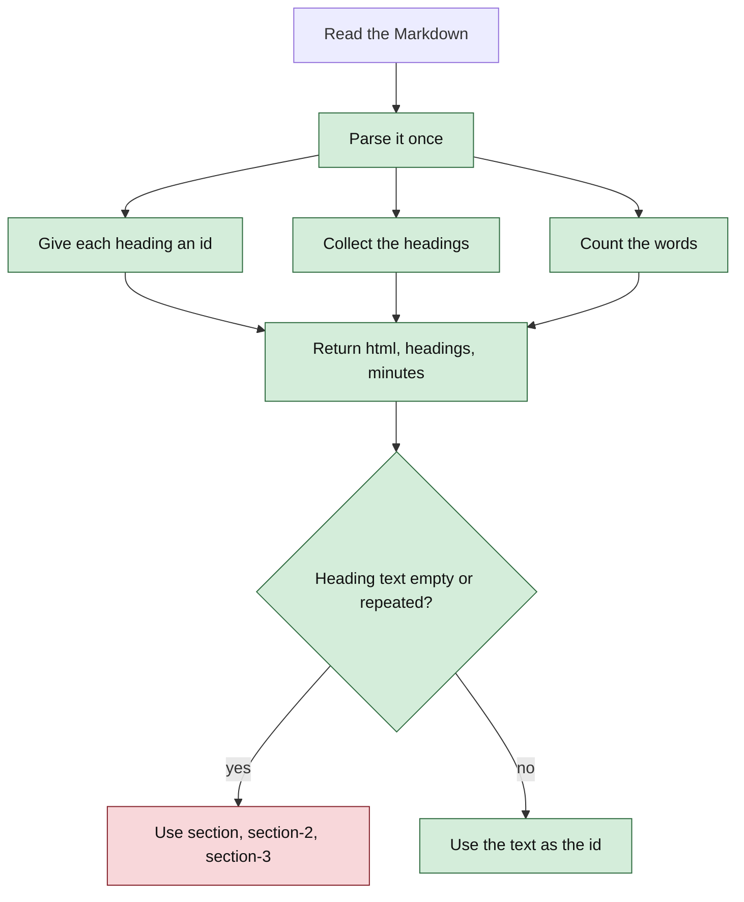

*Caption: green is new. Red is the edge case. Explainer: [adr-042-046-article-reading-aids.html](docs/visuals/adr-042-046-article-reading-aids.html).*

**Context:** `Article.tsx` calls `marked.parse` and puts the HTML in the page. A contents list, a section link and a reading time all need facts about the text. Those facts are the heading list, the heading ids and the word count.

**Options:**

| Option | How | Weakness |
|---|---|---|
| A. Search the finished HTML in the browser | After render, query `h2` and `h3`, set ids, build the list | Runs after paint. The list flickers in. Two sources of truth. |
| B. One parse with a `marked` renderer | A custom heading renderer sets ids and records headings during the parse | A small amount of new code in `src/lib/article.ts` |
| C. A build-time step | A Vite plugin writes headings into each chunk | New build code. Harder to test. |

**Choice:** Option B. `prepareArticle(markdown, basePath)` is a pure function that returns `html`, `headings` and `minutes`. It has no alias imports. Node 24 strips TypeScript types, so `node --test` can import it. I will write the tests first.

**Why:** The headings and the HTML come from the same pass, so they cannot disagree. A pure function is easy to test. The page has no flicker, because the list exists when the body is set.

**Given up:**

1. The reading time is an estimate with an assumed speed of 230 words per minute. I have no source for that number. A reader who reads faster or slower sees a wrong label. The label says "about".
2. Code blocks are not counted. A note with large code blocks reads longer than its label says.
3. `Article.tsx` gains logic, and `marked` is configured in one more place.

**Explainer ladder:** Levels 1, 2 and 3 are done. One explainer covers ADR-042 to ADR-046. No video.

## ADR-043: Section links use a query value, and the page shows a contents list and a progress bar

**Status:** Accepted by Saketh (2026-11-17). Built 2026-11-18. Not committed.

### Visual Level

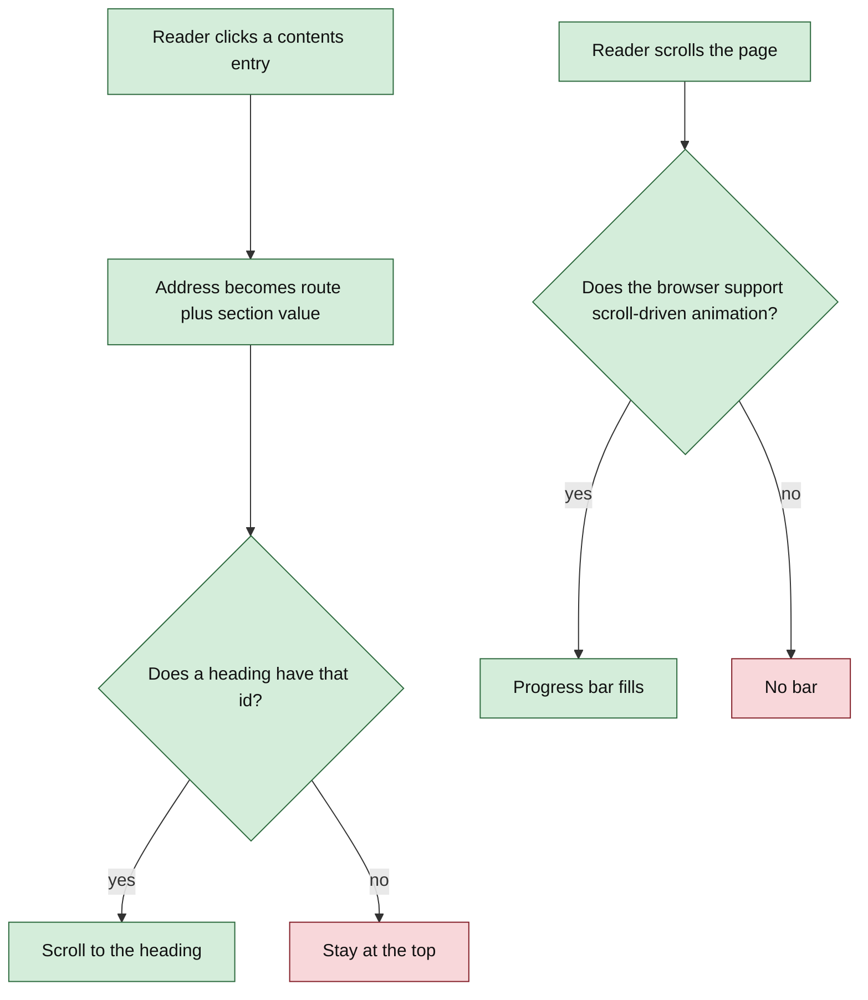

*Caption: green is new. Red is a quiet fallback. Explainer: [adr-042-046-article-reading-aids.html](docs/visuals/adr-042-046-article-reading-aids.html).*

**Context:** A reader cannot see the outline of a long note, cannot link to a section, and cannot tell how far they have read. The site uses `HashRouter`. It keeps the route after the `#`. A plain `#section` link would be read as a route and would show the Not found page.

**Options for section links:**

| Option | Result | Weakness |
|---|---|---|
| A. Plain `#id` anchors | Standard HTML | Breaks under `HashRouter` |
| B. Route plus `?section=id` | Works under `HashRouter`. A pasted link loads and scrolls. | The address is longer. A link preview cannot name the section. |
| C. Replace `HashRouter` with path routing | Clean addresses, `/writing/x#id` | Needs a `404.html` fallback on GitHub Pages. A separate, larger decision. |

**Choice:** Option B. The contents list and each heading anchor link to `#/<route>?section=<id>`. After the body renders, `Article` scrolls to the matching heading. The contents list is sticky at 1100 px and wider (`position: sticky` keeps it in view while the page scrolls). Below that, it is a closed `<details>` list. The list shows only when a page has 3 or more `h2` headings. The progress bar is a thin fixed bar. A CSS scroll-driven animation fills it, with no JavaScript. It is hidden when the reader prefers reduced motion.

**Why:** B fixes the real problem today and does not decide the routing question. A CSS-only bar adds no script and no scroll listener. A native `<details>` needs no script.

**Given up:**

1. Section links do not give a good link preview, because the section is in a query value.
2. The bar does not show in browsers without scroll-driven animation. I believe Firefox is one, and I will check.
3. The list does not highlight the section you are in. That needs an `IntersectionObserver`. I left it out until you ask for it.
4. The `<details>` list on a phone hides its entries from find-in-page until opened. I will test Chrome and Safari and record the result here.

**Explainer ladder:** Covered by the shared explainer. No video.

## ADR-044: Each note ends with a next note or two more notes

**Status:** Accepted by Saketh (2026-11-17). Built 2026-11-18. Not committed.

### Visual Level

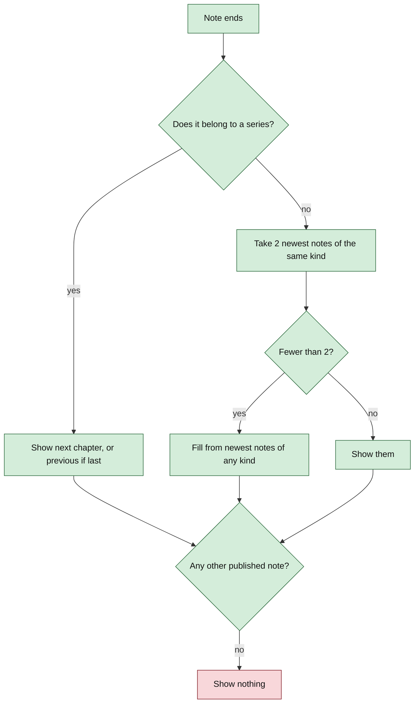

*Caption: green is new. Red is the empty case. Explainer: [adr-042-046-article-reading-aids.html](docs/visuals/adr-042-046-article-reading-aids.html).*

**Context:** The last line of a note is a dead end. The site has 25 published notes. One series, the GEO agent benchmark, has an order in the project's `notes` list.

**Options:**

| Option | Result | Weakness |
|---|---|---|
| A. Link by shared tags | True topic links | Needs a new `tags` field on 25 records. That is new data work. |
| B. Series order, else same kind, newest first | No new data. Easy to explain. | "Same kind" is a weak link. Two notes of one kind may not share a topic. |
| C. Hand-picked links per note | Best quality | 25 manual entries to keep up to date |

**Choice:** Option B. The label is "Next in this series" or "More notes". It never says "Related", because the rule does not know about topics. `endLinks(slug)` in `portfolio.ts` holds the rule.

**Why:** It needs no new data and it removes the dead end today. If topic links matter later, a `tags` field can replace the fallback rule in one function.

**Given up:**

1. Fallback links may point to a note on a different topic.
2. Case studies and experience pages get no end links in this change.
3. The newest-first rule favors recent notes over better-matching older ones.

**Explainer ladder:** Covered by the shared explainer. No video.

## ADR-045: On a phone, fold the technical focus line, shrink the title, and fade the table edge

**Status:** Accepted by Saketh (2026-11-17). Built 2026-11-18. Not committed.

### Visual Level

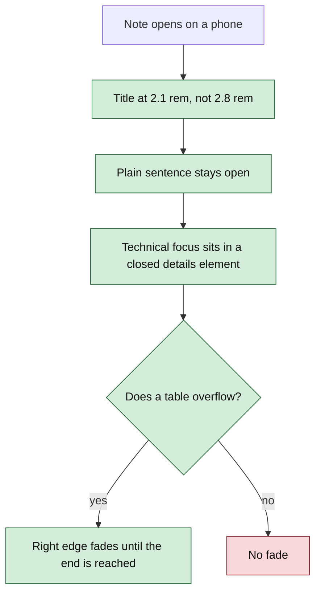

*Caption: green is new. Red is the no-overflow case, where nothing shows. Explainer: [adr-042-046-article-reading-aids.html](docs/visuals/adr-042-046-article-reading-aids.html).*

**Context:** At 375 px, the title (45 px), the plain sentence and the technical focus line fill the first screen. The body starts below it. Tables scroll sideways with no sign that more is hidden.

**Options for the header:**

| Option | Result | Weakness |
|---|---|---|
| A. Keep | Complete header | The body is off the first screen |
| B. Smaller title and a closed `<details>` for the technical focus line, on phones only | Body starts higher | Engineers must tap to read the focus line |
| C. Remove the focus line on phones | Shortest header | Deletes content from phones |

**Choice:** Option B. The `<details>` element starts open on wide screens and closed at 560 px and narrower. The `useIsMobile` hook sets this. Tables get a right-edge fade in CSS, using a gradient that scrolls with the content and shows only while more content is hidden. I will check the result in a screenshot before I ship.

**Why:** Project copy rule 1 puts the plain sentence first for a skimming reader. The technical focus line is the engineer's detail "one step lower". Folding it follows that rule. The title size drop is from 45 px to about 34 px.

**Given up:**

1. An engineer on a phone needs one tap to see the technical focus line.
2. Find-in-page may not search inside a closed `<details>`. I will test this.
3. If the page is resized across 560 px, the open state set at load may be wrong until reload. This is a small cost.
4. The fade is a hint. A reader can still miss a table that scrolls.

**Explainer ladder:** Covered by the shared explainer. No video.

## ADR-046: Draw diagrams by hand as SVG files, and add them to notes one by one

**Status:** Accepted by Saketh (2026-11-17). Built 2026-11-18. Not committed.

### Visual Level

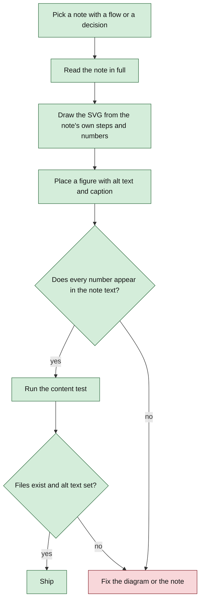

*Caption: green is new. Red is the fix loop. Explainer: [adr-042-046-article-reading-aids.html](docs/visuals/adr-042-046-article-reading-aids.html).*

**Context:** The site has four hand-drawn diagrams, all for the GEO benchmark. They sit in `public/diagrams/` and open in a new tab. The other 21 notes have none. A diagram helps when the text describes a flow, a loop or a decision. It does not help when it only decorates.

**Options:**

| Option | Result | Weakness |
|---|---|---|
| A. Mermaid in the browser | Diagrams as text in the Markdown | Adds a large dependency to the page. Needs theme setup. Renders after load. |
| B. Mermaid turned into SVG at build time | No runtime cost | Adds a headless-browser tool to the build |
| C. Hand-drawn SVG files | No dependency. Full control. Matches the four existing ones. | Slow to make. Each edit is manual. |

**Choice:** Option C, with a figure rule (see `api.md`): fixed `width` and `height`, an `alt` that states the reading, a one-sentence caption, and every number also present in the text. A content test checks that files exist and `alt` is set. Diagrams go in one note at a time.

**First batch (proposed, chosen from titles only, to confirm):**

| Note | Diagram idea |
|---|---|
| Ollama or MLX | Measurement setup: one model, two runtimes, the counters read, the quality check |
| Calibrate the judge before you trust the score | The loop: human labels, judge scores, agreement check, fix or stop |
| Evaluating retrieval failures separately from generation failures | A decision tree: was the right passage found, was it used, was the answer faithful |

Other candidates: stop a model call on silence (two timers on one timeline), rerank before you generate (retrieve many, rerank, pass few), and the System 1 guard (fast check, route, big model). I will read each note in full before I draw it. If the note does not state a step, the diagram does not show it.

**Why:** It adds no dependency. It keeps one visual style across the site. A person reading can trust that a diagram says what the text says.

**Given up:**

1. Each diagram costs real drawing time.
2. A diagram and its note can drift apart. The number check only catches numbers, not steps.
3. No interactive diagrams. A reader cannot hover or zoom beyond opening the image.
4. SVG text is not searchable by find-in-page when loaded as an ``.

**Explainer ladder:** Covered by the shared explainer. No video.

**Build result (2026-11-18, ADR-042 to 046).** All nine new tests pass, and the full suite of 19 passes. Lint and build pass. The `Article` chunk grew from 57.9 kB to 60.3 kB raw (18.8 kB gzipped). The entry script grew from 365.3 kB to 365.9 kB raw. Checked in the browser pane at 1440 px and 375 px: heading ids, sticky contents list, `?section=` scroll, progress bar, folded focus line, end links, table edge fade, and the three figures. Not checked: Safari, Firefox, and find-in-page inside a closed `<details>`. The table fade is partly hidden behind header cells, so header cells are now 55% transparent. Diagrams went into three notes: Ollama or MLX, Calibrate the judge, and Evaluating retrieval failures. I made the retrieval diagram a four-cell grid, not a decision tree, because it matches the note's own table. The four existing GEO figures gained `width` and `height` so the content test could cover them.

---

# Change 2026-11-19: ADR-047 to ADR-050 (revision 2, not yet approved)

Revision 2 follows an independent review. See "Review 1" in `architecture.md`. The biggest change: ADR-047 no longer puts note text in the static files.

Explainer for all four: [adr-047-050-paths-metadata-writing.html](docs/visuals/adr-047-050-paths-metadata-writing.html).

## ADR-047: Use real page addresses and write one HTML file per route, with its own head tags

**Status:** Accepted by Saketh (2026-11-19). Built 2026-11-19, not merged. Replaces ADR-007 and answers the "separate, larger decision" in ADR-043.

### Visual Level

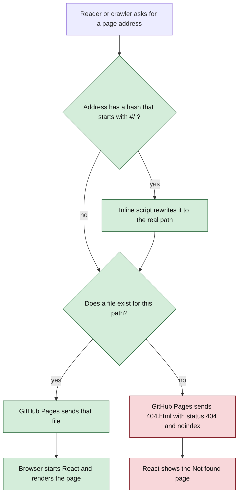

*Caption: green is new, red is the unknown-address path. Today every address gets the same `index.html`, and the crawler never reaches step D, because it drops the hash.*

**Context:** A crawler ignores the part of an address after `#`. With `HashRouter`, all 54 pages look like one page to search. LinkedIn also previews every link as the home page. ADR-007 kept `HashRouter` until the host could do rewrites. GitHub Pages cannot do rewrites, but it can serve one file per path, and it serves `404.html` for unknown paths.

**Options:**

| Option | Result | Weakness |
|---|---|---|
| A. Keep `HashRouter` | No work | Notes cannot rank. Previews stay wrong. |
| B. `BrowserRouter` plus a `404.html` that is a copy of `index.html` | Clean addresses | GitHub Pages sends status 404 for every note. Crawlers treat 404 pages as errors. |
| C. `BrowserRouter` plus one HTML file per route with its own head tags, and no note text | Real addresses, status 200, right title and preview per page. Google runs JavaScript, so it reads the body. | A small build plugin. Crawlers that do not run JavaScript see an empty body. |
| D. Option C plus the rendered note text inside each file | Also helps crawlers without JavaScript | Needs wrapper markup, an H1, styles and a no-flash plan. The first draft chose this and the review rejected it. |
| E. A server-side rendering framework (`vite-react-ssg`, Next.js) | Full static pages | New dependency tree, new entry points, rewrites a working app |

**Choice:** Option C. A Vite plugin at the end of `vite build` writes the files (`architecture.md`, `api.md`). Old `#/` links are rewritten in the browser by an inline script. Links inside notes are rewritten by the Markdown renderer, and a click handler sends them to the router.

**Why:** It fixes the cause (one file for all routes) with the least change. It keeps the app and the host. Status codes are correct: 200 for known pages and 404 for unknown ones.

**Given up:**

1. **A build step that can fail.** If the plugin breaks, the deploy stops. This is on purpose, but it is a new way to be blocked.
2. **No note text in the static files.** Link-preview bots and search engines that do not run JavaScript see tags but no body. Google does run it. Not proven for this site.
3. **Old `#/` links work only in a browser.** A crawler and a link-preview bot never run the rewrite, so they still see the home page for old links. Share the new addresses from now on.
4. **Link handling in notes.** 28 notes hold `#/` links. A renderer change, a click handler and a test are now part of this work.
5. **`/research` returns 404 before it redirects**, unless it gets its own file. The route table gives it one.
6. **Unverified host behavior.** The 404 status, the trailing-slash redirect and the `Sitemap:` line are not tested on GitHub Pages. See `architecture.md`, open questions 2 and 3.

## ADR-048: Give each page its own title, description, canonical address and share tags, and publish a sitemap

**Status:** Accepted by Saketh (2026-11-19). Built 2026-11-19, not merged.

### Visual Level

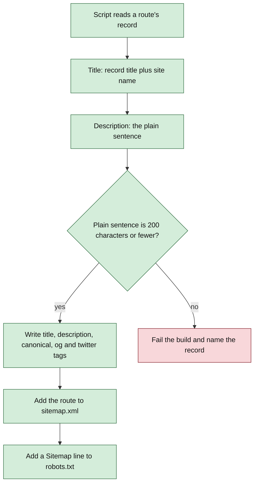

*Caption: green is new, red is the failure path. Today the head tags are the same text on every page, and no sitemap exists.*

**Context:** Every page has the home page title and description. No `<link rel="canonical">` exists. The sitemap returns 404. ADR-047 gives each route a file, so each file can carry its own tags.

**Options:**

| Option | Result | Weakness |
|---|---|---|
| A. Keep one set of tags | No work | Search and previews show the same text for every page |
| B. Set tags in the browser with a head library | Works for the reader's tab title | A crawler or preview bot that does not run JavaScript sees the old tags |
| C. Write tags into each file at build time | Every consumer sees the right tags | Part of the plugin from ADR-047 |

**Choice:** Option C. The title is `<record title> | Saketh Velidimalla`. The description is the `plain` sentence, which the copy rules already limit to 25 words. The build warns above 160 characters and fails above 200. Four records are above 160 today (the GEO benchmark ones, up to 178 characters). The image stays the shared `og-image.png`. `404.html` gets `noindex`. Saketh sends `sitemap.xml` to Google Search Console and Bing by hand, because crawlers read `robots.txt` only at the host root.

**Why:** The copy rules already require a plain sentence of 25 words or fewer on every record. Reusing it means no new text to write and no second source to keep in step.

**Given up:**

1. **One share image for all pages.** A note's preview shows the same picture as the home page.
1a. **Manual step.** Sitemap submission is a person's task. The `Sitemap:` line in this site's `robots.txt` may be ignored.
2. **Descriptions are not tuned for search.** They are written for a skimming reader, by the copy rules. They may not use the words people search for.
3. **No `lastmod` dates in the sitemap** unless a record has a date. Work items have `updated`, notes have `date`, and the pages `/work/` and `/writing/` have none.
4. **A hard limit can block a deploy.** A 201-character sentence fails the build.

## ADR-049: Writing page: tags on series rows, tag filter and a "Start here" row

**Status:** Accepted by Saketh (2026-11-19). Built 2026-11-19, not merged. Builds on ADR-034 and the tags merged in PR #4.

### Visual Level

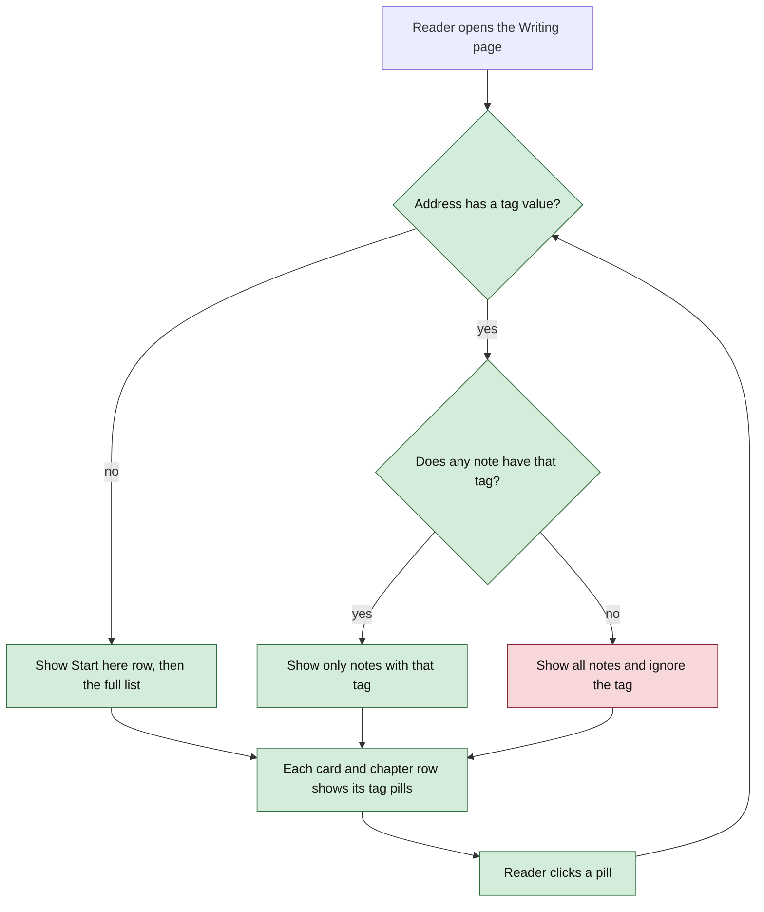

*Caption: green is new. Red is the unknown-tag path, which falls back to the full list. Today the pills are not links, and chapter rows have no pills.*

**Context:** 32 notes carry 97 pills (47 different tags). 24 list cards show pills. The 8 notes inside series show pills only in the article header. A reader cannot act on any pill. The list is newest first, so the three strongest notes can sit far down.

**Options:**

| Option | Result | Weakness |
|---|---|---|
| A. Leave it | No work | Pills do nothing. Series notes are untagged on the list. |
| B. Pills filter the list | A reader can follow a topic | A second filter next to `?kind=`. More states to test. |
| C. B plus a "Start here" row | The best notes are first | A hand-kept list that goes stale |

**Choice:** Option C. A record gets an optional `pin` number. The page shows records with a `pin` above the list, sorted by that number, three at most. A pinned series chapter shows as a note card. The tag filter uses `?tag=<name>` (URL-encoded) and combines with `?kind=`. While a tag is active, series cards are replaced by flat note cards. An unknown tag shows the full list, like an unknown `kind` today.

**Why:** Tags and pins use data that already exists or is one field. No new page, no new dependency.

**Given up:**

1. **The pin list is hand-kept.** It is Saketh's choice and can go stale.
2. **A note can show twice**: in "Start here" and in the list below. We accept this, because hiding it from the list would make the list incomplete.
3. **Tag names must match exactly.** `RAG` and `rag` are two tags. A test checks that no two tags differ only by case. No separate tag list exists. The tags come from the records.
4. **No read time on cards** (open question 4 in `architecture.md`).

### Amendment to ADR-049 (2026-11-19): read time on list cards

Open question 4 asked for read time on the cards. Saketh asked for it. Status: built 2026-11-19, not merged.

#### Visual Level

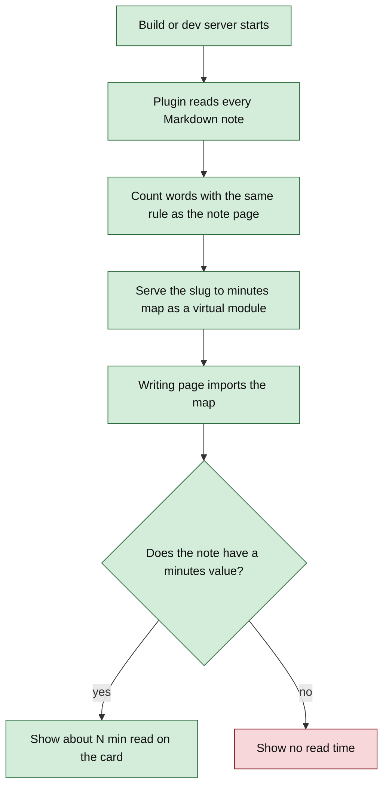

*Caption: green is new. Red is the path for a card with no Markdown file, which shows no label. Level 3 explainer: skipped. The change adds no new failure path and no step outside this chart, so level 2 already shows every step.*

**Options:**

| Option | Result | Weakness |
|---|---|---|
| A. Load every note into the Writing page | Simple code | The list page would carry all 32 notes, about 250 kB of text |
| B. A generated data file kept in the repo | Small | Goes stale when a note changes |
| C. A virtual module built from the Markdown at build time | Small (about 1 kB), always current, one counting rule | A new Vite plugin |

**Choice:** Option C. `src/lib/readingTime.ts` holds the one counting rule. The note page and the plugin both use it. A test checks that every card value equals the note page value.

**Given up:**

1. A second small Vite plugin to maintain.
2. The reading speed (230 words a minute) is an assumption with no source. Every label says "about".
3. Series chapter rows show no read time. The series card shows the sum of its chapters.
4. A note with no Markdown file, such as a planned note in dev, shows no label.

## ADR-050: The plain sentence of a pinned note states its result

**Status:** Accepted by Saketh (2026-11-19). Built 2026-11-19 for the three pinned notes, not merged. Saketh approved the final wording, which differs from the first System 1 draft below.

### Visual Level

```mermaid
flowchart TD
    A[Pick a pinned note] --> B[Read the note's own numbers]
    B --> C[Draft a plain sentence with the result]
    C --> D{Is each number in the note text?}
    D -- yes --> E[Saketh approves the sentence]
    D -- no --> F[Remove the number or fix the note]
    E --> G{25 words or fewer, 200 characters or fewer?}
    G -- yes --> H[Replace the plain sentence]
    G -- no --> C
    classDef new fill:#d4edda,stroke:#2d6a3e,color:#111
    classDef fail fill:#f8d7da,stroke:#842029,color:#111
    class A,B,C,D,E,G,H new
    class F fail
```

*Caption: green is new, red is the fix path. Today the plain sentence of each pinned note names the topic, not the result.*

**Context:** The System 1 note's plain sentence says "what three models did on 60 hard test questions". It does not say what they did. Reviewers read for seconds. CLAUDE.md copy rule 1 says the plain sentence names "the problem or the result". Rule 3 allows a number only if it is on the résumé or Saketh confirmed it.

**Options:**

| Option | Result | Weakness |
|---|---|---|
| A. Leave the sentences | No work | The result stays hidden |
| B. Add a new `takeaway` field | A second sentence on each note | A second thing to keep in step, and two lines say almost the same thing |
| C. Rewrite `plain` for the pinned notes | One sentence, no new field | Needs Saketh's approval per sentence |

**Choice:** Option C. Approved sentences (2026-11-19):

| Note | Sentence |
|---|---|
| System 1 guard | A small first check sorted 60 hard questions into safe, off topic and attack with 0 mistakes, about three times faster than Gemini. (23 words) |
| Calibrate the judge | Agreement with people can look high while the judge catches nothing, so score failures and passes separately before trusting a judge. (21 words) |
| Retrieval and generation failures | Scoring retrieval and the written answer separately shows which step failed, so you fix the right one. (17 words) |

The first draft said "ran faster than the big model" and "refused attacks". Both were dropped. The first named an unclear comparison, and the second overclaimed, because the note says the old path was already safe. The two method notes hold no result of Saketh's own, so their sentences state the main point and carry no number.

**Why:** The plain sentence is already the first thing a reader sees, and it feeds the search description (ADR-048). One sentence serves both.

**Given up:**

1. **Fewer notes get the treatment.** Only the three pinned notes change now.
2. **A result sentence can overclaim.** Every number must also appear in the note, and Saketh approves the wording.
3. **Search and reader copy are one sentence.** If search needs different words, we cannot tune them apart.

## Open questions (all four ADRs)

See `architecture.md`, open questions 1 to 7. In short: a Vite plugin or a `tsx` script, manual sitemap submission, the trailing-slash redirect, which three notes to pin, read time on cards, light theme, a per-note share image, and fixing `architecture.md` line 410 after the change ships.

Also: the System 1 draft sentence above says the small check "ran faster than the big model". The note's table shows Jev (204 ms median) against Gemini (587 ms). Saketh must confirm that the sentence names the right comparison.

**Build result (2026-11-19, ADR-047 to 049).** `npm test` passes (33 tests, 15 new). Lint passes with no errors. Type check shows only the `toSorted` errors that existed before. `vite build` writes 43 route files, `sitemap.xml` (42 addresses) and `404.html`, and warns about 5 descriptions between 164 and 184 characters. Checked in the browser pane against a small server that copies GitHub Pages rules (files per path, `404.html` with status 404, a 301 for a missing trailing slash): an old `#/writing/x?section=y` link became `/writing/x/?section=y` and scrolled to the section; `/research/` answered 200; an unknown path answered 404 with `noindex`; a pill click filtered the list and replaced the series card with its notes; an in-note link moved to another note without a reload; the Start here row shows at 375 px with no sideways scroll. **Changes beyond the drafts:** (1) The review missed that notes use relative paths such as `diagrams/x.svg`. They broke on `/writing/<slug>/`, so the renderer now points every relative `src` and `href` at the site base, with a test. (2) A page does not reload on a client-side move, so the tab title stayed stale. A small `usePageTitle` hook now sets it on each page. **Not checked:** the real GitHub Pages host (404 status, the redirect from a path without a slash, the `Sitemap:` line), Safari and Firefox, and a full-repo lint run (only the changed code was linted). **Not done:** the manual sitemap submission, and the plain sentences of ADR-050.

## ADR-052: Explain the question and takeaway in portfolio summaries

**Status:** Implemented in source, not merged (2026-11-19).

**Context:** Project and note cards often named a system or listed measurements without saying why the work was done. A reader had to open the note to learn the question or intended use.

**Decision:** Use the short `plain` copy for the question or goal and the practical takeaway. Keep the exact setup, numbers, and technical scope in `summary`, and retain caveats such as public-data-only validation. Apply this to Home, Work, Experience, and Writing cards through their shared data records. Keep the existing research evidence and avoid adding claims not supported by the published note or project record.

**Rejected:** Add a separate “why” field and new UI labels. The current card layouts already show a short plain line and longer technical line, so clearer copy can solve the problem without changing the content schema or page behavior.

**Teach-back:** not required. Copy-only change; no schema, data flow, or interface behavior changes.

## ADR-051: Add a light theme and a toggle, and keep dark as the look of today

**Status:** Accepted by Saketh (2026-11-19). Built 2026-11-19, not merged. Build result at the end of this ADR.

### Visual Level

Explainer (level 3): [docs/visuals/adr-051-light-dark-theme.html](docs/visuals/adr-051-light-dark-theme.html)

```mermaid
flowchart TD
    A[Browser asks for a page] --> B[Inline script reads saved choice]
    B --> C{Saved choice found?}
    C -- yes --> E[Set theme class on the page root]
    C -- no or storage blocked --> D[Read the system setting]
    D --> E
    E --> F[React starts and reads the same class]
    F --> G[Page paints with that theme's colors]
    G --> H[Reader clicks the toggle]
    H --> I{Can the browser save the choice?}
    I -- yes --> J[Save choice and swap class]
    I -- no --> K[Swap class for this visit only]
    classDef new fill:#d4edda,stroke:#2d6a3e,color:#111
    classDef fail fill:#f8d7da,stroke:#842029,color:#111
    class B,C,D,E,F,H,I,J new
    class K fail
```

*Caption: green is new, red is the failure path. Today the site has one dark theme, set in `:root`, and no step in this chart exists.*

**Context:** The site has one dark theme. Every color comes from CSS variables in `src/index.css`, so a second set of values is a small change. Some parts do not use the variables: three diagram colors in `ParticleBackground.tsx`, one gradient in `index.css`, and 17 SVG files in `public/diagrams/` with dark fills written into each file. `architecture.md` open question 5 says light theme needs its own ADR. This is that ADR.

**Decisions inside this ADR:**

| # | Question | Options | Choice |
|---|---|---|---|
| 1 | How does the page switch theme? | A. A `dark` class on `<html>`. B. A `data-theme` attribute. C. Only `prefers-color-scheme`, no toggle. | A. `tailwind.config.ts` already has `darkMode: ["class"]`. Option C gives the reader no control. |
| 2 | Who manages the state? | A. `next-themes` (already installed, `sonner.tsx` imports it). B. A new hook of about 20 lines. | A. It adds no dependency and it makes the toast theme follow the page. |
| 3 | How do we avoid a flash of the wrong theme? | A. Rely on `next-themes` alone. B. A small inline script in `index.html`. | B, together with A. `next-themes` runs after React starts, so the first paint can show the wrong theme. The script runs before paint. |
| 4 | Which theme shows first? | A. Follow the system setting. B. Always dark until the reader chooses. | A. Confirmed by Saketh (2026-11-19). |
| 5 | How many toggle states? | A. Two (light, dark). B. Three (light, dark, system). | A. The first visit follows the system. After one click the choice is saved. Three states need more UI for little gain. |

**Choice:** Put the dark values in `.dark` and the light values in `:root`. Add the inline script to `index.html`. Wrap the app in `next-themes` `ThemeProvider` with `attribute="class"`. Add a `ThemeToggle` button to the site header. Add a test that checks every text and background token pair in both themes meets WCAG AA (4.5 to 1 for text).

**Why the contrast test:** The current purple (`263 74% 70%`) is about 3 to 1 on white. It would fail on a light page. The light theme needs a darker purple. A test fails the build if a later edit breaks this. Nobody has to remember to check.

**Given up:**

1. **No-JavaScript readers see the light theme.** Today they see dark. The site works without JavaScript only for the page text, and crawlers run JavaScript, so the effect is small.
2. **One more thing to check on every new page.** A new component must use the tokens and not a fixed color. The test covers tokens only. It cannot see a fixed color in a component.
3. **Diagrams stay dark in both themes** if open question 2 goes as proposed. On a light page they look like dark panels. That is a visible compromise.
4. **About 20 more lines of code in the first paint path.** The inline script blocks paint for a few microseconds. A wrong script would break every page, because all 43 route files copy `index.html`.
5. **The first impression may change for recruiters.** A recruiter on a light-mode computer now sees a light site, not the dark one Saketh chose.

**Build result (2026-11-19, ADR-051).** `npm test` passes (60 pass, 1 skipped). Lint passes on the changed files. The type check shows no new errors. `vite build` writes 43 route files, and the theme script is in the ones I checked. Checked in the browser pane: with no saved choice and a light system, the page is light. A click gives dark, saves `theme=dark`, and the choice holds across a page move. At 375 px the header fits with no sideways scroll, and code blocks stay dark on a light page. **Skipped test:** `destructive-foreground` on `destructive` in the dark theme is 4.19 to 1. The dark values are the old look, so I left them. **Not checked:** the dark-system first paint (this pane cannot emulate it for local pages), the flash on a slow connection, Safari and Firefox, the 17 diagrams on a light page, and a screenshot of every page in light. **Not done:** the explainer in dark mode.

# Change 2026-11-19: the home page carries one thread (ADR-053 to ADR-058, proposed)

All six ADRs share one level 3 explainer: [docs/visuals/adr-053-058-home-thread.html](docs/visuals/adr-053-058-home-thread.html). It shows the home page from top to bottom. It marks each section that stays, changes or goes, and what happens when a data record is missing.

**Where this came from.** A review on 2026-11-19 found three problems. The home page lists true facts but no thread. The same facts repeat: "140,000 employees" shows 3 times and GEO shows 4 times. The best proof is hidden. 16 diagrams exist, and none is on the home page. The confirmed 10 percentage point result is only on the Experience page. Saketh then set the thread and the audience:

1. **The thread.** Now: he finds why AI fails, as a data engineer and data scientist on a production RAG platform. Next: he goes down the stack toward systems engineering.
2. **The audience.** He applies for AI evaluation and data roles in the next 3 to 6 months. The "next" part supports the claim. It is not the headline.
3. **Featured projects.** GEO agent benchmark, SakethWiki and Lekhni. SDLC Intelligence Agent leaves the home page.
4. **Office work needs no evidence.** His description of his job duties is the source (2026-11-19). Copy rule 3 still limits numbers to the ones he confirmed.

## ADR-053: The hero states one thread: find why AI fails now, go down the stack next

**Status:** Accepted by Saketh (2026-11-19). Built 2026-11-19, not merged.

### Visual Level

Explainer (level 3): [docs/visuals/adr-053-058-home-thread.html](docs/visuals/adr-053-058-home-thread.html)

```mermaid
flowchart TD
    A[Reader opens the home page] --> B[Read the eyebrow: the role applied for]
    B --> C[Read paragraph 1: what I do now, with one result]
    C --> D[Read paragraph 2: the same question, one layer lower]
    D --> E[See the stack ladder]
    E --> F{Does the reader want proof?}
    F -- yes --> G[Open a proof card or a ladder rung]
    F -- no --> H[Reader leaves with one sentence to remember]
    classDef new fill:#d4edda,stroke:#2d6a3e,color:#111
    classDef fail fill:#f8d7da,stroke:#842029,color:#111
    class B,C,D,E new
    class H fail
```

*Caption: green is new or changed copy. Red is the reader who leaves early. Today that reader leaves with a list of topics, and after this change they leave with one sentence.*

**Context:** The eyebrow says "Applied AI Systems Engineer". That is the title Saketh wants next, not the one he applies for. Paragraph 1 has two keyword lists and no result. Paragraph 2 lists four things that do not connect. The footer says "from production LLM quality to machine intelligence", which says nothing.

**Options:**

| Option | Result | Weakness |
|---|---|---|
| A. Keep the copy and trim the lists | Smaller change | Still no thread |
| B. Lead with the systems direction | Matches the long-term goal | Mismatches the eval and data roles he applies for now, and the résumé title |
| C. Lead with "now", give "next" one line and the ladder | Matches the applications and keeps the direction visible | The systems direction gets less space |

**Choice:** Option C. New copy:

| Place | Text |
|---|---|
| Eyebrow | AI Evaluation & Data Engineer |
| Role line | Data scientist building production AI evaluation and data systems · Python, SQL, PySpark, AWS (no change) |
| Paragraph 1 | I find out why production AI gives wrong answers, and I build the data that shows it. On a RAG platform used by about 140,000 employees, I write the ETL pipelines, build the reports and KPIs with the business, and trace each failure to retrieval, ranking, generation or handoff. |
| Paragraph 2 | Outside work, I ask the same question one layer lower: how agents read the web, and how local models behave under heat and memory limits. Next, I am learning networking and embedded hardware. |
| Footer | I find why AI systems fail, and I am learning the layers underneath. |

The role line keeps its tool list. The test in `tests/homepage-positioning.test.mjs` asks for it, and recruiters search for those words.

**Why:** A Staff Engineer gives the page about 30 seconds. One sentence must survive that. The eyebrow then matches the jobs he applies for.

**Given up:**

1. **The eyebrow no longer claims the systems title.** A systems-role reader sees "evaluation and data" first.
2. **"Applied AI Systems Engineer" leaves the page title and share tags too** (open question 1, resolved yes). Search results and old share previews change.
3. **Paragraph 1 is longer** than one short sentence. It must name both halves of the job, data and evaluation.
4. **A test changes.** `homepage-positioning.test.mjs` asserts the old eyebrow. ADR-039 set that eyebrow on purpose. This ADR replaces that part of ADR-039.

## ADR-054: A stack ladder replaces the eight topic pills

**Status:** Accepted by Saketh (2026-11-19). Built 2026-11-19, not merged.

### Visual Level

Explainer (level 3): [docs/visuals/adr-053-058-home-thread.html](docs/visuals/adr-053-058-home-thread.html)

```mermaid
flowchart TD
    A[Read the ladder records] --> B[Take one rung per layer, top to bottom]
    B --> C{Does the rung have a link?}
    C -- no --> D[Draw the rung as text marked learning]
    C -- yes --> E{Does the link target exist and is it published?}
    E -- yes --> F[Draw the rung with its link]
    E -- no --> G[Fail the test before the build ships]
    F --> H[Mark the top rung as depth today]
    D --> H
    classDef new fill:#d4edda,stroke:#2d6a3e,color:#111
    classDef fail fill:#f8d7da,stroke:#842029,color:#111
    class A,B,C,D,E,F,H new
    class G fail
```

*Caption: green is new. Red is the failure path. Today eight pills link to notes, and one pill, "Hardware (learning)", links to a case study about something else.*

**Context:** The eight pills are a tag cloud. They show range but not order. Saketh's thread has an order: the product layer is his depth today, and hardware is where he is going.

**Options:**

| Option | Result | Weakness |
|---|---|---|
| A. Keep the pills | No work | No order, no thread |
| B. A drawn SVG of the stack | Looks like a diagram | Hard to keep in step with the notes, does not follow the theme, links inside an image are hard to reach by keyboard |
| C. An ordered HTML list styled as a ladder | Real links, follows both themes, screen readers read it as a list | Looks less like a drawing |

**Choice:** Option C. Six rungs, top to bottom:

| Layer | Work | Link |
|---|---|---|
| Product | Production RAG evaluation and data | `/experience/enterprise-ai-quality` |
| Agents | GEO agent benchmark, MCP tools | `/work/geo-agent-bench` |
| Models | System 1 decision models | `/writing/system-one-guard-for-rag` |
| Runtimes | Ollama against MLX, chip counters | `/writing/ollama-vs-mlx-benchmark` |
| Network | DNS, Web Bot Auth, OAuth | `/writing/geo-agent-bench-setup` |
| Hardware | ESP32, Arduino (learning) | none |

The top rung carries the label "depth today". The bottom rung carries "learning". A test checks that each link points to a record that exists and is published.

**Why:** The ladder is the thread drawn as one object. Each rung opens proof that already exists.

**Given up:**

1. **Two pill topics lose their own link.** "Small models" and "Security" fold into the Models and Network rungs.
2. **The Hardware rung has no proof.** It says "learning" in plain words. A reader can see that nothing is published yet.
3. **The ladder can go stale.** A new note does not add itself. Someone must edit the records.
4. **The hero gets taller on a phone.** Six rungs take more height than two rows of pills.

## ADR-055: Each fact shows in one place, and the proof cards show three kinds of proof

**Status:** Accepted by Saketh (2026-11-19). Built 2026-11-19, not merged.

### Visual Level

Explainer (level 3): [docs/visuals/adr-053-058-home-thread.html](docs/visuals/adr-053-058-home-thread.html)

```mermaid
flowchart TD
    A[List each fact on the home page] --> B{Does the fact show in more than one section?}
    B -- no --> C[Keep it where it is]
    B -- yes --> D[Keep it in the section that owns it]
    D --> E[Replace the other copies with a different fact]
    E --> F{Is each number confirmed or published?}
    F -- yes --> G[Use the new copy]
    F -- no --> H[Remove the number]
    classDef new fill:#d4edda,stroke:#2d6a3e,color:#111
    classDef fail fill:#f8d7da,stroke:#842029,color:#111
    class A,B,D,E,F,G new
    class H fail
```

*Caption: green is new. Red is the path for a number that nobody confirmed. Today "140,000 employees" shows 3 times and GEO shows 4 times on one page.*

**Context:** The production proof card repeats paragraph 1 of the hero. The J&J experience row repeats it again. The GEO proof card says "the tests show when alternate formats save tokens and where identity checks still fail". That sentence promises a finding but does not state it. The SakethWiki card lists features ("capture, chat, review, browse") and not the idea behind them.

**Who owns which fact:**

| Section | Owns |
|---|---|
| Hero | The thread, the 140,000 user count |
| Production proof card | The data pipelines and the 10 percentage point result |
| Experience row (J&J) | The scope of the role |
| GEO proof card | One security finding |
| GEO featured card | The test design and the results block (ADR-058) |
| Research block | The evaluation notes (ADR-057) |

**Choice:** New card copy:

| Card | Claim | Evidence |
|---|---|---|
| Production | I build the data pipelines, reports and KPIs behind a production RAG platform, and I trace why it gives wrong answers. | Glue jobs move DynamoDB data into S3 as Parquet files for Power BI. I build the reports, set KPIs with the business and own the stakeholder relationship. One round of fixes raised self-service resolution by 10 percentage points. |
| GEO | I built test websites to see how AI agents behave when a page tries to steer them. | A spoofed agent with a valid sign-in token still read a protected page. (FINDINGS.md, finding 5) |
| SakethWiki | My notes app suggests edits but asks before it changes a saved note. | An AI correction cannot silently overwrite the source. The screenshot stays. |

The J&J experience row on home shows: "I build the pipelines, KPIs and failure triage behind a production RAG platform." It no longer reuses `caseStudy.plain`, so the 140,000 figure stops repeating. The Experience page keeps `caseStudy.plain` as it is.

**Why:** A repeated fact reads as padding. Padding reads as generated text. Three different proofs say more than one proof three times.

**Given up:**

1. **The home row and the Experience page drift apart.** The home row gets its own sentence, so two sentences describe one role.
2. **The tool names appear in a proof card.** Copy rule 2 keeps tools out of the plain claim. Here they sit in the evidence line, which is one step lower, but a non-engineer still reads them.
3. **A test changes.** `homepage-positioning.test.mjs` asserts that the row reuses `item.caseStudy.plain`. ADR-039 chose that reuse to avoid a duplicate metric. This ADR solves the duplicate a different way.

## ADR-056: Feature GEO, SakethWiki and Lekhni, with one card layout

**Status:** Accepted by Saketh (2026-11-19). Built 2026-11-19, not merged.

### Visual Level

Explainer (level 3): [docs/visuals/adr-053-058-home-thread.html](docs/visuals/adr-053-058-home-thread.html)

```mermaid
flowchart TD
    A[Take the three featured work records] --> B[Draw title, status label and plain line]
    B --> C{Does the record have a diagram?}
    C -- yes --> D[Draw the diagram thumbnail]
    C -- no --> E[Draw the card without a thumbnail]
    D --> F[Draw the scope line]
    E --> F
    F --> G[Draw the links row: repository, proof link, case study]
    G --> H{Is a link field missing?}
    H -- yes --> I[Leave that link out]
    H -- no --> J[Show all links]
    classDef new fill:#d4edda,stroke:#2d6a3e,color:#111
    classDef fail fill:#f8d7da,stroke:#842029,color:#111
    class A,C,D,G,H new
    class E,I fail
```

*Caption: green is new or changed. Red is the path when a record lacks a field, and the card still draws. Today each card shows an index number, a tag row and no diagram.*

**Context:** SDLC Intelligence Agent is the weakest fit for "I find why AI fails". Lekhni fits: it has model traces, failure checks and evals, and it led to the Ollama against MLX benchmark. Three existing links are missing from cards:

1. GEO: `FINDINGS.md` is not on the card.
2. SakethWiki: the published note `sakethwiki-system-design` has a diagram, but the card has no link to it.
3. Lekhni: the card says "Private", but the public repository `lekhni-app` exists. Only the activity list links to it.

**Options for the card layout:**

| Option | Result | Weakness |
|---|---|---|
| A. Keep the layout, change the copy | Small change | Index numbers and tag rows stay as noise, and still no diagram |
| B. Cut the index and tags, add a thumbnail and one links row | Each card shows its proof | Two new optional fields on `WorkItem` |
| C. Make each card a full diagram panel | Strong visual | Too tall, three tall panels push the research block off the first screens |

**Choice:** Option B.

| Card | Plain line | Scope line | Thumbnail | Links |
|---|---|---|---|---|
| GEO | No change | 190 tests, exact-answer scoring, no model as judge. Covers llms.txt and markdown, MCP tools, Web Bot Auth and OAuth. | `system-overview.svg` | Repository · Findings · Case study |
| SakethWiki | A notes app that suggests edits but asks before it changes a saved note. | No change | `sakethwiki-two-paths.svg` | Repository · System design |
| Lekhni | A meeting-to-notes tool that keeps recordings on my Mac. Every note it writes carries a trace I can review. | No change | `lekhni-recording-path.svg` | Repository · Case study |

Set `featured: false` on `sdlc-intelligence-agent` and `featured: true` on `lekhni`. Its build log stays on `/writing`, and the project stays on `/work`.

**Why:** A card that shows a diagram and links to real code reads as engineering, not description.

**Given up:**

1. **Tags leave the home cards.** A reader who scans for "RAG" or "OAuth" finds the words only in the scope line. The Work page keeps tags.
2. **The diagrams are dark panels in the light theme.** ADR-051 open question 2 leaves all 17 diagrams dark. A thumbnail on a light page shows that compromise at a larger scale.
3. **SDLC leaves the home page.** It is the only CI/CD and code-review project, so that range is no longer visible from home.
4. **The Lekhni repository link shows a smaller tool.** `lekhni-app` is a local LLM that turns meeting transcripts into summary notes (Saketh, 2026-11-19). The live transcription and call detection on the card stay in the private repository.

## ADR-057: The research block shows the three evaluation notes, and "Other work shipped" goes

**Status:** Accepted by Saketh (2026-11-19). Built 2026-11-19, not merged.

### Visual Level

Explainer (level 3): [docs/visuals/adr-053-058-home-thread.html](docs/visuals/adr-053-058-home-thread.html)

```mermaid
flowchart TD
    A[Look up the three pinned evaluation notes] --> B{Is each note published?}
    B -- yes --> C[Draw the card with its diagram and result line]
    B -- no --> D[Leave that card out]
    C --> E[Link to all research notes]
    D --> E
    E --> F[Skip the shipped list]
    F --> G[Draw the contact section]
    classDef new fill:#d4edda,stroke:#2d6a3e,color:#111
    classDef fail fill:#f8d7da,stroke:#842029,color:#111
    class A,B,C,F new
    class D fail
```

*Caption: green is new or changed. Red is the path for a note that is not published. Today the block shows e-means and two GEO chapters, and a shipped list follows it.*

**Context:** The research block shows the e-means clustering study and two GEO chapters. Neither answers "why AI fails" for an evaluation reader. The GEO chapters repeat the featured card. The notes that fit the role best are the three pinned notes, and none of them is on the home page. The "Other work shipped" section opens with "Things I shipped beyond the research above, not commit counts." That sentence talks about the page. Two of its four rows repeat featured projects.

**Options for the shipped list:**

| Option | Result | Weakness |
|---|---|---|
| A. Keep it | No work | Repeats the featured cards, and the intro is defensive |
| B. Shrink it to a three-line changelog | Shows the site is alive | Still a fourth list on the page |
| C. Remove it from home | A shorter page that ends on contact | Recent activity is no longer visible from home |

**Choice:** Swap in `system-one-guard-for-rag`, `calibrate-your-llm-judge` and `retrieval-vs-generation-failures`. These are the pinned notes. ADR-050 approved result sentences for them, but the records carry the ADR-052 wording today (found at build, see the build result). Each card shows the note's existing diagram. The heading becomes "How I find failures". Remove the shipped list from home (option C). The `activity` data stays. `/work` can use it later.

**Why:** The notes that match the job should be the ones on the job's front page.

**Given up:**

1. **e-means leaves the home page.** It is the most recent research note and the only one about classic ML. It stays on `/writing`.
2. **No sign of recent activity on home.** A reader cannot see that work shipped this month without opening another page.
3. **The research block and the "Start here" row on `/writing` show the same three notes.** A reader who clicks through sees them again.
4. **Two tests change.** `emeans-positioning.test.mjs` asserts the e-means slug on home. `homepage-positioning.test.mjs` asserts the "Other work shipped" heading.

## ADR-058: The GEO card shows real results in a terminal-style block

**Status:** Accepted by Saketh (2026-11-19). Built 2026-11-19, not merged.

### Visual Level

Explainer (level 3): [docs/visuals/adr-053-058-home-thread.html](docs/visuals/adr-053-058-home-thread.html)

```mermaid
flowchart TD
    A[Read the result lines from the GEO record] --> B{Is any line present?}
    B -- no --> C[Draw the card without the block]
    B -- yes --> D[Draw a monospace block titled From FINDINGS.md]
    D --> E[Link the title to FINDINGS.md]
    E --> F{Does each line match FINDINGS.md?}
    F -- yes --> G[Ship]
    F -- no --> H[Fix the line before merge]
    classDef new fill:#d4edda,stroke:#2d6a3e,color:#111
    classDef fail fill:#f8d7da,stroke:#842029,color:#111
    class A,B,D,E,F,G new
    class C,H fail
```

*Caption: green is new. Red is a missing or wrong line. Today the home page shows no output from any project.*

**Context:** The review asked for one lightweight showcase of real engineering on the home page. A live demo needs a server and an API key. GEO has the strongest published numbers, in `FINDINGS.md` in its public repository.

**Options:**

| Option | Result | Weakness |
|---|---|---|
| A. A live interactive demo | Most impressive | Needs a hosted backend and a key, and costs money per visit |
| B. A fake terminal with a `$ geo-bench results` command | Looks like a real run | No such command exists. That is a fake. |
| C. A monospace block of real result lines, titled with its source | Honest, static, cheap | Looks less like a live run |

**Choice:** Option C. Four lines, each copied from `FINDINGS.md`:

```
markdown links   relative 0/8   absolute 8/8
input tokens     html 101k · llms.txt 86k · interceptor 33k (6 tasks, 1 run)
sign-in check    spoofer with a valid OAuth token read the protected page
small model      Qwen3-8B   plain fetch 0/12   bounded harness 12/12
```

The block title is "From FINDINGS.md", and it links there.

**Why:** Real numbers in a fixed-width block read as engineering at a glance. The source link lets a skeptical reader check them in one click.

**Given up:**

1. **Two copies of the numbers.** If `FINDINGS.md` changes, the home block does not change with it. A person must update both.
2. **The limits shrink.** `FINDINGS.md` gives a limit for each finding. The block keeps only "6 tasks, 1 run". The rest live one click away.
3. **The GEO card gets taller** than the other two cards. The grid rows can look uneven.
4. **The lines wrap in a narrow card.** Each line renders as a label column and a value column (a `<dl>`), so values wrap and nothing scrolls sideways. The fixed-width line-up of a terminal is lost.

## Open questions (ADR-053 to ADR-058)

1. **Page title and meta description.** The old title is in 4 places. They are `src/hooks/usePageTitle.ts` line 5 and `index.html` lines 6, 39 and 46. `public/og-image.png` may show it too. I have not opened that image. **Resolved 2026-11-19: yes, change all of them in this change.** This touches search results and share previews (ADR-048).
2. **The light theme and the thumbnails.** See ADR-056, given up item 2. **Resolved 2026-11-19: ship them dark, as ADR-051 does for notes.**
3. **Ladder rung for Models.** **Resolved 2026-11-19: "System 1 decision models", linked to `system-one-guard-for-rag`.** The note uses the same term: a fast model that makes one small decision before the large model answers. The judge note stays in the research block.
4. **Lekhni link label.** **Resolved 2026-11-19: "Repository".** `lekhni-app` is not a public version of Lekhni. It is a local LLM meeting-notes taker that turns transcripts into summaries. The `activity` entry for 2026-09-22 calls it "a public version of the notes layer". That text may need a fix, outside this change.
5. **ADR-039 and ADR-035.** This change replaces parts of both: the eyebrow (ADR-039) and the home Research selection (ADR-035 amendment). After approval, mark those parts superseded in place.
6. **Tests.** Three test files assert the old copy. The build updates them to assert the new copy. Their intent is to stop drift, and that intent stays.

**Build result (2026-11-19, ADR-053 to ADR-058).** Built, not committed, not merged.

1. **Tests:** `npm test` gives 65 pass, 0 fail, 1 skipped. The new file `tests/home-thread.test.mjs` adds 6 tests. Three old files now assert the new copy. Before this change, 3 tests failed.
2. **Lint and types:** lint passes on the changed files. The type check shows no errors except the `toSorted` errors that existed before.
3. **Build:** `vite build` passes and writes 43 route files. It first failed on two descriptions over the 200 limit, from commit 4b263c1: `/work/geo-agent-bench/` (203 characters) and `/writing/geo-agent-bench-phase-a/` (207). Saketh approved shorter plain sentences (2026-11-19): GEO now has 108 characters and Phase A has 165. The Phase A sentence drops the name-spoofing scanner clause. The note still covers it. The home head in `dist/index.html` carries the new title.
5. **Production build in the browser (`vite preview`, base `/sakethai-portfoliogen/`):** the title, eyebrow, 6 rungs and 4 result rows render. All 7 home images answer 200. The console shows no errors.
4. **Browser check (dev server):** at 1280 px dark, the hero, ladder, proof cards, featured cards and research cards render. At 375 px light, nothing scrolls sideways (page width 375). The console shows no errors.

**Changes beyond the ADRs:**

1. **Grid fix.** The results block stretched its grid column. `.featured-card` now has `min-width: 0`.
2. **Results render as a label and value list,** not a `<pre>`. The 76-character lines scrolled sideways even at desktop width. The `results` strings did not change. ADR-058 given up item 4 is updated.
3. **Alt text** for the six thumbnails comes from each SVG's own `aria-label`, shortened.
4. **The link label "Read the case study" on featured cards is now "Case study",** to fit one links row.
5. **The GEO `summary` keeps "Qwen and Claude agent runs; observed Anthropic and OpenAI crawler traffic".** `tests/geo-positioning.test.mjs` guards that wording (ADR-038). The `plain`, `summary` and `featured` fields are shared, so the Work page shows the new SakethWiki, Lekhni and GEO copy too.

**Found at build, fixed after merge (2026-11-19, asked by Saketh):**

1. The three pinned notes now carry the result sentences that ADR-050 approved. Before, they carried the ADR-052 wording.
2. The résumé page description in `scripts/routes.ts` now says "an AI evaluation and data engineer".
3. The `activity` entry of 2026-09-22 now says `lekhni-app` is a separate public tool: a local LLM that turns meeting transcripts into summary notes.

**Not checked:** the real GitHub Pages host, Safari and Firefox, and the tablet width.

## ADR-059: Home cards show the real tools and methods behind each project

**Status:** Accepted by Saketh (2026-11-19), with the six lists as proposed. Built 2026-11-19, not merged. Asked for by Saketh: "write the tags like System 1 Jev (TypeSafe AI API was used for the decision model), Render was used for RAG Mini, any complex algorithm".

### Visual Level

Explainer (level 3): skipped. The change has one decision and no new path: a card draws a list if the record has one. The chart below shows every step and the one fallback.

```mermaid
flowchart TD
    A[Read a featured project or research note record] --> B{Does it have a stack list?}
    B -- no --> C[Draw the card without a tool row]
    B -- yes --> D[Draw up to 6 tool chips under the scope line]
    D --> E{Is each tool named in the note or repo?}
    E -- yes --> F[Ship]
    E -- no --> G[Remove that tool before merge]
    classDef new fill:#d4edda,stroke:#2d6a3e,color:#111
    classDef fail fill:#f8d7da,stroke:#842029,color:#111
    class A,B,D,E,F new
    class C,G fail
```

*Caption: green is new. Red is the fallback for a record with no list, and the check for a tool that no note names. Today the home cards show no tools.*

**Context:** ADR-056 removed the tag row from home cards. Those tags were broad topics, such as "RAG" and "Evaluation". They repeated the scope line. Saketh now wants the specific tools and methods on the card: the services, models and algorithms a technical reader would ask about. Examples: Jev from TypeSafe AI made the System 1 decision, and RAG Mini runs on Render.

**Options:**

| Option | Result | Weakness |
|---|---|---|
| A. Bring back the old `tags` | No new field | Broad topics, and `tags` also drives the filter on `/writing` (ADR-049). Specific tool names would flood the filter. |
| B. Write the tools into the scope line | No new field | The scope line gets long again, and tools are hard to scan in prose |
| C. A new `stack` list, shown as small chips on home cards | Specific, scannable, apart from the filter | A third list per record to keep true |

**Choice:** Option C. A new optional field `stack?: string[]` on `WorkItem` and `PublicationItem`. At most 6 entries. Each one names a tool, service, model or method that the note or repository names. Home cards draw it as a row of chips under the scope line. The `/work` and `/writing` pages do not show it yet.

**Proposed lists.** Each entry comes from the note named in the right column. Saketh confirms each list.

| Card | Stack | Source |
|---|---|---|
| System 1 guard (RAG Mini) | Jev decision model (TypeSafe AI) · Gemini · Qwen3-8B on Ollama · Qdrant Cloud · Render · Fail-closed guard | `system-one-guard-for-rag` |
| Calibrate the judge | True positive and true negative rates · Cohen's kappa · Held-out split · Binary pass or fail labels | `calibrate-your-llm-judge` |
| Retrieval and generation failures | Two-by-two failure grid · Separate retrieval and answer scores · Knowledge-gap label · Suspicious-pass check | `retrieval-vs-generation-failures` |
| SakethWiki | FastAPI · React · SQLite index · Embeddings with rerank · Review queue · JSONL trace log | `sakethwiki-system-design` |
| GEO agent benchmark | Web Bot Auth signed requests · OAuth · MCP tools · llms.txt · Cloudflare DNS and Caddy · Exact-answer scoring | `geo-agent-bench-overview`, `-setup`, `-signatures` |
| Lekhni | Swift with Core Audio process tap · Parakeet transcription · Python FastAPI · Ollama and MLX · SQLite · Traces and evals | `lekhni-system-design` |

**Why:** A technical reader decides in seconds whether the work is real. "Jev decision model, Qdrant Cloud, Render" says more than "RAG".

**Given up:**

1. **A third list to keep true.** `tags`, `summary` and `stack` can drift apart. Nothing checks `stack` against the notes automatically.
2. **The cards get taller.** Six chips take one or two more lines in a narrow card.
3. **Copy rule 2 bends.** Tool names sit on the card, one line below the plain sentence. They stay out of the plain sentence itself.
4. **The method notes have thin lists.** The two method notes name methods, not tools. Their chips describe the method, which is less striking than a product name.

### Open questions (ADR-059)

1. Are the six lists right? Add or remove any tool. Saketh's office tools (Glue, DynamoDB, Power BI) are already in the production proof card, so they are not repeated here.
2. Should `/work` and `/writing` show `stack` too? Proposal: not in this change.
3. The calibration note mentions Llama once. I did not read whether it is a tool you used or an example from a source, so I left it out.

**Build result (2026-11-19, ADR-059).** `npm test` gives 67 pass, 0 fail, 1 skipped. Two new tests check the list limits and that both card types draw the row. Lint passes on the changed files. The type check shows no new errors. `vite build` writes 43 route files. In the dev server, all 6 cards show their chips (6, 6, 6, 6, 4, 4) at 1280 px light. At 375 px dark, nothing scrolls sideways. **Change beyond the ADR:** the slug `geo-agent-bench` names both a work record and a publication. The list goes on the work record. **Not checked:** Safari and Firefox, and the tablet width.

# Change 2026-11-19: the Work page is curated first, then an archive (ADR-060 to ADR-062, proposed)

All three ADRs share one level 3 explainer: [docs/visuals/adr-060-062-work-page.html](docs/visuals/adr-060-062-work-page.html). It shows the Work page from top to bottom after the change. It also shows the GEO findings section and each failure path.

**Where this came from.** A review on 2026-11-19 used the same audit as the home page. It found four problems:

1. **The header is not true.** It says each entry states whether it is deployed work, a prototype or learning work. Only 6 of 22 entries have that label.
2. **The one live AI system is hidden.** RAG Mini runs on Render, and its demo answered 200 on 2026-11-19. It sits in "Experiments & learning", which starts folded.
3. **Every project has the same weight.** The page is about 6,200 px tall, and nothing says where to stop.
4. **The findings are off the site.** The seven GEO findings, each with its evidence and limit, live only in `FINDINGS.md` on GitHub. The home card links there.

Saketh chose "curated, then archive" for the Work page (2026-11-19).

## ADR-060: The Work page shows five selected projects as full cards, then a compact archive

**Status:** Accepted by Saketh (2026-11-19).

### Visual Level

Explainer (level 3): [docs/visuals/adr-060-062-work-page.html](docs/visuals/adr-060-062-work-page.html)

```mermaid
flowchart TD
    A[Reader opens the Work page] --> B[Read the header: five projects, then everything else]
    B --> C[Draw five selected cards in a fixed order]
    C --> D{Is each selected slug a work record?}
    D -- no --> E[Test fails before the build ships]
    D -- yes --> F[Draw label, plain line, diagram, scope, tools, links]
    F --> G[Draw the archive: one line per remaining project]
    G --> H{Is the archive group empty?}
    H -- yes --> I[Skip that group]
    H -- no --> J[Draw the group heading and its lines]
    classDef new fill:#d4edda,stroke:#2d6a3e,color:#111
    classDef fail fill:#f8d7da,stroke:#842029,color:#111
    class B,C,D,F,G,H,J new
    class E,I fail
```

*Caption: green is new or changed. Red is a failure path or a skipped group. Today the page draws four groups of full rows, and two groups start folded.*

**Context:** Today every project gets a full row with a scope line, generic tags and every note title. GEO alone lists 10 note titles inline. RAG Mini, with its live demo, is folded. RoastRank, a résumé scorer from December 2025 with no note, sits in "Flagship systems". Three ML notebook projects say almost the same thing in three rows.

**Options:**

| Option | Result | Weakness |
|---|---|---|
| A. Keep the archive, fix the copy | Small change | Still no order, and RAG Mini stays hidden |
| B. Curated cards, then a compact archive | The strongest proof comes first, and every project stays reachable | Two layouts on one page, and a fixed list to keep up to date |
| C. Show only the best projects | Shortest page | Real work disappears from the site, and GitHub becomes the archive |

**Choice:** Option B.

**Selected, in this order.** The list lives in `Work.tsx`, the same way the home page holds its research list.

| # | Project | Plain line | Links |
|---|---|---|---|
| 1 | GEO agent benchmark | No change | Code · Seven findings (ADR-061) · Case study |
| 2 | RAG Mini | A document Q&A app, live on Render, with a small model that screens each question before Gemini answers. It sorted 60 hard questions with 0 mistakes. | Live demo · Code · System 1 note |
| 3 | SakethWiki | No change | Code · System design |
| 4 | Lekhni | No change | Repository · Case study |
| 5 | SDLC Intelligence Agent | A GitLab bot that reviews each change against security policy and explains why a pipeline failed. | Code · Build log |

Each selected card shows the evidence label, title, plain line, diagram thumbnail, scope line, tool chips (ADR-059) and links. It shows the 2 most important notes and a link "All N notes", not every title. RAG Mini and SDLC get a label, a diagram and a tool list:

| Project | Label | Diagram | Tools |
|---|---|---|---|
| RAG Mini | Public prototype | `system-one-guard-flow.svg` | Jev decision model (TypeSafe AI) · Gemini · Qdrant Cloud · FastAPI and React · Render |
| SDLC Intelligence Agent | Public prototype (already set) | `sdlc-agent-routing.svg` | GitLab webhooks · Plain-function orchestrator · Four agents · Policy retrieval from a vector store · Pipeline log analysis · Weekly Slack digest |

**The archive.** Every other project gets one line: title, plain line, and a code or case-study link. There are no tags, no scope line and no folds. The groups are:

1. Developer tools.
2. Experiments & learning. RoastRank moves here (open question 1).
3. Automations & creative builds. This renames "Creative builds", and AI & Tech Policy Digest moves into it.

Two archive lines change:

| Record | New line |
|---|---|
| `ml-fundamentals` (merges the three ML notebook projects, links all three repositories) | ML fundamentals in three notebook series: classical algorithms, loss and optimization, perceptrons to networks. |
| `leetcode-coach` | A browser extension that gives hints and visuals for data-structure problems, not answers. |

SakethWiki's `updated` date becomes 2026-10-08, the date of the conflict-review release in `activity`.

**Header:** "Five projects that show how I find AI failures, then everything else I have built." The `/work/` route description in `scripts/routes.ts` changes to match.

**Why:** A reviewer reads the first screen. The first screen must hold the five projects that back the home page claim. Everything else stays one click away and costs one line.

**Given up:**

1. **A fixed list to maintain.** A new strong project does not appear on top until someone edits the list.
2. **Archive projects lose detail.** Their scope lines and tags stop showing. A reader who wants the stack must open the repository.
3. **Three ML records become one.** Each notebook series loses its own line and its own date.
4. **The folds go.** The archive is short enough to show open. If it grows, the page grows.
5. **Two lists overlap with home.** GEO, SakethWiki and Lekhni are on both pages. The Work page shows more about them, but a reader sees them twice.

## ADR-061: The seven GEO findings move onto the site, in the case study

**Status:** Accepted by Saketh (2026-11-19). Asked for by Saketh: "add this in the portfolio too, why send towards GitHub?"

### Visual Level

Explainer (level 3): [docs/visuals/adr-060-062-work-page.html](docs/visuals/adr-060-062-work-page.html)

```mermaid
flowchart TD
    A[Reader clicks Findings on a home or Work card] --> B[Open the GEO case study at the findings section]
    B --> C[Read seven findings: claim, number, limit]
    C --> D{Does the reader want the method?}
    D -- yes --> E[Follow the link to the chapter that measured it]
    D -- no --> F[Reader leaves with the results]
    B --> G{Does the section id exist?}
    G -- no --> H[Page opens at the top, section test fails]
    classDef new fill:#d4edda,stroke:#2d6a3e,color:#111
    classDef fail fill:#f8d7da,stroke:#842029,color:#111
    class A,B,C,D,E new
    class H fail
```

*Caption: green is new or changed. Red is the failure path. Today the Findings link opens `FINDINGS.md` on GitHub, and the case study has a shorter five-point list.*

**Context:** `FINDINGS.md` lists seven findings. Each one has its evidence and its limit. The site has the same facts, but they are spread over 10 chapters. The case study `geo-agent-bench-overview` has a shorter list, "What I would tell an engineer who builds for agents". That list gives advice, not evidence. A reader who wants "what did you find" must leave the site.

**Options:**

| Option | Result | Weakness |
|---|---|---|
| A. Keep the GitHub link | No work | The reader leaves the site, and GitHub renders it as a code file |
| B. A new note, `/writing/geo-agent-bench-findings` | A page of its own | An eleventh GEO note, and a reader must find it |
| C. A "Seven findings" section in the case study | The project page answers "what did you find" | The case study gets longer |

**Choice:** Option C. Add a section "Seven findings" after "What exists" in `geo-agent-bench-overview.md`. Each finding has:

1. A one-line claim, from `FINDINGS.md`.
2. The number, from `FINDINGS.md`.
3. The limit, from `FINDINGS.md`.
4. A link to the chapter that measured it.

The text is a copy-edit of `FINDINGS.md`, not new claims. The section id is `seven-findings`. The links change:

| Place | Today | After |
|---|---|---|
| Home GEO card, "Findings" link | `FINDINGS.md` on GitHub | `/work/geo-agent-bench?section=seven-findings` |
| Home GEO results block title | "From FINDINGS.md", to GitHub | "From the seven findings", to the same section |
| Work GEO card | none | "Seven findings", to the same section |
| "Code" link | GitHub repository | No change |

**Why:** The site should answer the main question about its main project. GitHub stays the place for code.

**Given up:**

1. **Two copies of the findings.** `FINDINGS.md` stays in the repository for code readers. If it changes, the site does not change with it.
2. **The case study gets longer,** by about 350 words.
3. **The "What I would tell an engineer" list overlaps** with the findings. It stays, because it gives advice and the findings give evidence. A reader sees some facts twice on one page.
4. **A section link can break.** If someone renames the heading, the id changes and the links open at the top of the page. A test checks the id.

## ADR-062: Remove the commit chart from the Work page

**Status:** Accepted by Saketh (2026-11-19).

### Visual Level

Explainer (level 3): skipped for this ADR. It removes one section and has no flow. The shared explainer shows the page without it.

```mermaid
flowchart TD
    A[Work page draws the archive] --> B{Is the commit chart still on the page?}
    B -- yes, today --> C[Draw a snapshot chart dated 2026-11-04]
    B -- no, after --> D[Draw the GitHub archive link]
    C --> D
    classDef new fill:#d4edda,stroke:#2d6a3e,color:#111
    classDef fail fill:#f8d7da,stroke:#842029,color:#111
    class B,D new
    class C fail
```

*Caption: green is the path after the change. Red is the step that goes. The GitHub archive link exists today and stays.*

**Context:** The chart shows commits per month from a snapshot dated 2026-11-04, public repositories only. Its own caption says "Commits are not deployments." The June bar shows 1 commit, which raises a question the page cannot answer. An evaluation reader learns nothing about evaluation from it.

**Options:**

| Option | Result | Weakness |
|---|---|---|
| A. Keep it | No work | Stale, and it invites a question about June |
| B. Refresh it with private repositories | More current | Still a vanity metric, and the refresh is manual |
| C. Remove it and its orphan files | A shorter page | Activity over time is no longer visible |

**Choice:** Option C. Remove `<CommitChart />` from `Work.tsx`. Delete the files that only the chart uses: `src/components/CommitChart.tsx`, `src/data/commits.ts` and `scripts/update-commits.sh`. Remove the chart CSS.

**Why:** The page should show work, not volume.

**Given up:**

1. **No sign of steady activity.** A reader who looks for consistency loses the one chart that showed it.
2. **The refresh script goes.** Bringing the chart back means rewriting it from git history.

## Open questions (ADR-060 to ADR-062)

1. **RoastRank.** **Resolved 2026-11-19: archive.**
2. **Job Tracker.** **Resolved 2026-11-19: add an archive line** under Developer tools, private. Its line comes from the `activity` entry: a macOS app that turns job-application emails into a tracked pipeline.
3. **Render sleep.** **Resolved 2026-11-19: it sleeps.** The demo link reads "Live demo (may take a moment to wake)".
4. **SDLC tool list.** **Resolved 2026-11-19:** taken from the published note `sdlc-intelligence-agent-design`. Saketh said to go ahead.

**Build result (2026-11-19, ADR-060 to ADR-062).** Built, not merged.

1. **Tests:** `npm test` gives 72 pass, 0 fail, 1 skipped. The new file `tests/work-page.test.mjs` adds 5 tests.
2. **Lint, types, build:** lint passes on the changed files. The type check shows no new errors. `vite build` writes 43 route files.
3. **Browser check (dev server):** at 1280 px light, the five selected cards render in order with diagrams, tools and links. The RAG Mini link reads "Live demo (may take a moment to wake)". The archive shows three groups (8, 4 and 4 lines). The Work page is about 5,000 px tall, down from about 6,200. The "Seven findings" link opens the case study, which scrolls to the section. At 375 px dark, nothing scrolls sideways.

**Changes beyond the ADRs:**

1. **Extra notes fold.** Notes beyond the first two fold under "N more", not under a "All N notes" link. The Writing page has no filter by project, so a link had no good target.
2. **The thumbnail and chip parts moved** from `Index.tsx` to `src/components/CardParts.tsx`, because both pages now use them (architecture.md, "Shared pieces").
3. **`demoNote` field.** A new optional `demoNote` field holds the Render warning, so the warning text lives with the record.
4. **`directors-lab` also moved** into "Automations & creative builds". It was the third record in the old group.
5. **Finding 7 has no note.** The case study's Phase F row now says "Finding 7 above", in place of the GitHub link. The OpenAI probe has no note of its own.
6. **The RAG Mini System 1 note** shows in the notes list, not as a separate link.

**Not checked:** the dev-server console kept old hot-reload errors from before the reload. The dev-server log shows no errors. Also not checked: Safari and Firefox, the tablet width, and the live Render demo after a wake.

## ADR-063: Publish the goal-contract experiment as a research note

### Visual Level

```mermaid
flowchart TD
    A[Experiment repo is public with code, docs and write-up] --> B[Add a research note and its chart]
    B --> C[Add the publication record]
    C --> D{Do content tests and the build pass?}
    D -- no --> E[Fix the note. Do not deploy]
    D -- yes --> F[Deploy the site]
    F --> G{Does the live page load with its chart?}
    G -- no --> H[Revert the note and redeploy]
    G -- yes --> I[Note is live on the Writing page]

    classDef old fill:#e5e5e5,stroke:#777,color:#222
    classDef new fill:#cfe3ff,stroke:#2a62b8,color:#10264d
    classDef fail fill:#ffd6d6,stroke:#b82a2a,color:#4d1010
    class A,F old
    class B,C,D,G,I new
    class E,H fail
```

Caption: Grey exists today: the public experiment repo and the deploy step. Blue is new. Red is a failure path. Level 3 explainer: skipped. This change adds content and one record. It has no new flow, and level 2 shows each step and both failure paths.

**Status:** Proposed 2026-11-21.

**Context.** The goal-contract experiment finished with a clear result. A log that the system writes from the human's prompts kept every owner decision. Notes that the agent had to write itself scored 0.19 to 0.25. The repo is public at github.com/Sakethv7/goal-contract-experiment. The full write-up there is long and written as a lab record, with twelve scenarios and every deviation listed.

**Options.**
1. Link the repo write-up from a Work card only.
2. Publish a short research note on the site that leads with the result, and link the repo for detail (this ADR).
3. Copy the full write-up onto the site.

**Decision.** Option 2. One Research note, dated 2026-11-21, with the S9 table and chart first, the twelve tests in four lines, the limits, and a link to the repo. No Work card and no home-page change, as with ADR-040's choice not to duplicate one artifact.

**Evidence invariant.** Public copy may state: 81 valid runs, $7.38, the system-written log and the goal tree at 1.0 at 1, 3 and 6 decisions, agent notes at 0.25, 0.25 and 0.19, no memory at 0, 17 of 24 notes runs that never wrote a decision, no erasure and no drift seen. It must also state: one model (Claude Haiku), one task family, 8 runs per cell, a pilot not proof, and that the notes arm had no reminder in its prompts.

**Consequences.** One Markdown file, one SVG chart under `public/goal-contract/`, one publication record and one content test.

**What we gave up.** The site version drops the per-scenario detail and the deviation list. A reader who wants them must open the repo. The note is not on the home page, so fewer visitors will see it.

## ADR-064: Rewrite note openings and site copy in plain language

### Visual Level

```mermaid
flowchart TD
    A[Saketh flags the notes as declarative and hard to read] --> B[Write the writing rules into the project CLAUDE.md]
    B --> C[Rewrite each note opening in everyday words]
    C --> D[Remove slogan lines and introduce each person and company]
    D --> E[Retitle four slogan notes and update links to them]
    E --> F[Rewrite the home hero and the case study summary]
    F --> G{Do content tests and the build pass?}
    G -- no --> H[Fix the copy. Do not deploy]
    G -- yes --> I{Does Saketh approve the new copy?}
    I -- no --> J[Revert the files he rejects]
    I -- yes --> K[Deploy the site]

    classDef old fill:#e5e5e5,stroke:#777,color:#222
    classDef new fill:#cfe3ff,stroke:#2a62b8,color:#10264d
    classDef fail fill:#ffd6d6,stroke:#b82a2a,color:#4d1010
    class A,K old
    class B,C,D,E,F,G,I new
    class H,J fail
```

Caption: Grey exists today: the request and the deploy step. Blue is new. Red is a failure path. Level 3 explainer: skipped. This is a copy change with no new flow, and level 2 shows every step and both failure paths.

**Status:** Proposed 2026-11-21.

**Context.** Saketh read the notes and found them declarative. Lines such as "Without them, quality is a feeling" and titles such as "Traces nobody opens are not observability" read as slogans. Cited people appeared with no context ("Husain", "Shankar"). Openings assumed the reader knew terms such as RAG, grain or watermark. A non-engineer could not follow the first paragraph of several notes.

**Options.**
1. Rewrite every note in full.
2. Rewrite the parts a reader meets first, and the slogan and jargon lines anywhere in the body (this ADR).
3. Leave the bodies and change only titles and plain lines.

**Decision.** Option 2. Each note's opening now states the situation, what I did and what I found, in everyday words. Slogan sentences become plain statements. Each cited person and company gets a few words of context at first mention, taken from their own sites. Each technical term gets a plain gloss at first use, and keeps its precise name (2026-10-09 override). Four slogan titles become descriptive titles, and links that used the old titles are updated. Two notes, the trace note and the NoSQL note, were rewritten in full because most of their sentences were slogans. The home hero, the research section intro and the case study summary use the same rules. The rules are in the project CLAUDE.md under "Writing rules for notes", so later notes follow them.

**Evidence invariant.** No fact, number, hedge, source or limit was removed. Content-test phrases stay as they were. The 140,000 figure still appears once on the home page (ADR-055).

**Consequences.** About 30 Markdown files, `portfolio.ts`, `experience.ts`, `Index.tsx` and `CLAUDE.md` change. Slugs do not change, so no link breaks.

**What we gave up.** The notes are longer in places, because a gloss adds words. Some voice is lost: a few lines that read well as slogans are now plain. The résumé bullets on the Experience page were not rewritten, because they must match the published résumé. The GEO series and the newer local-model notes got only light edits, because they already followed most of the rules.

**Open questions.** Saketh mentioned a repo with anti-slop rules. No link reached this session. Its rules are not applied yet.
