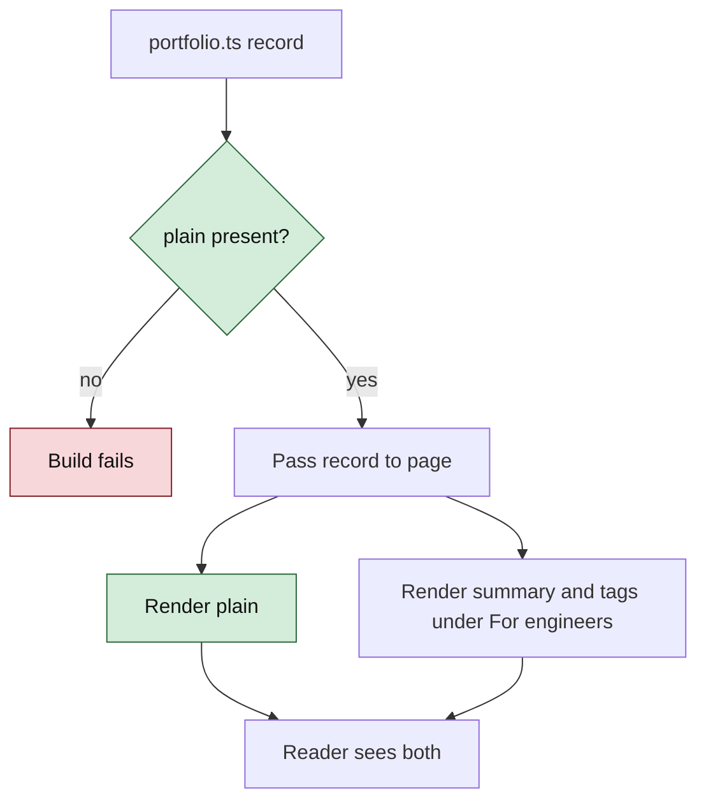
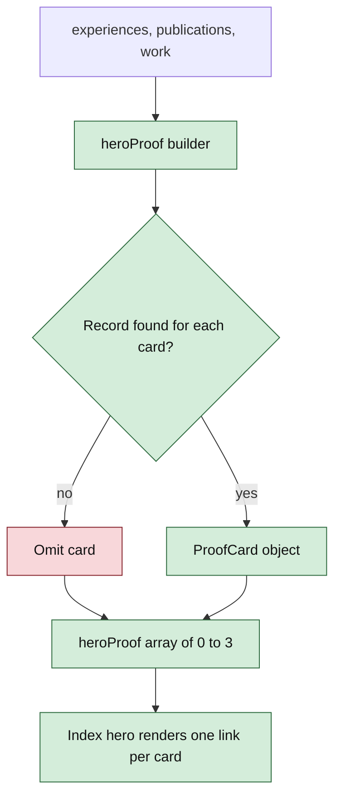
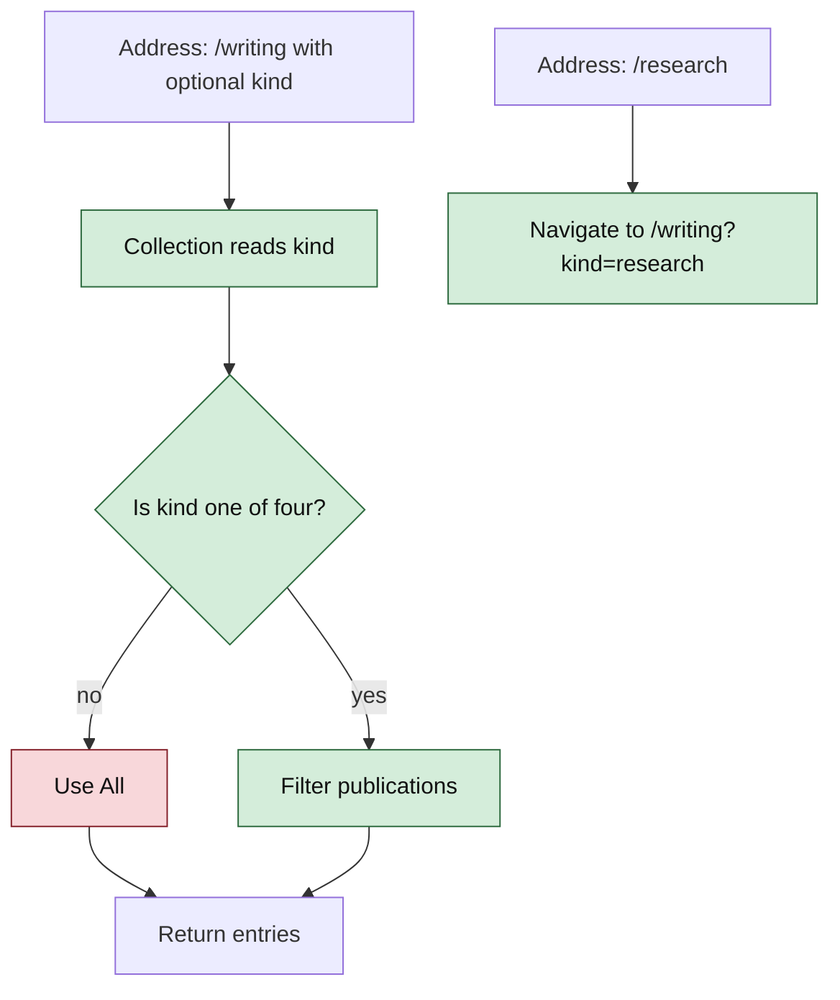
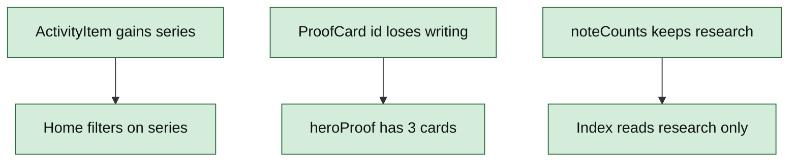
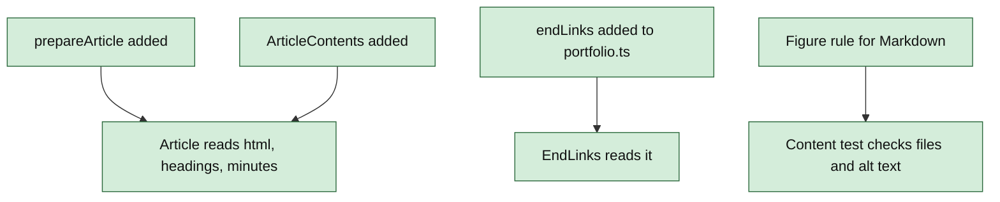
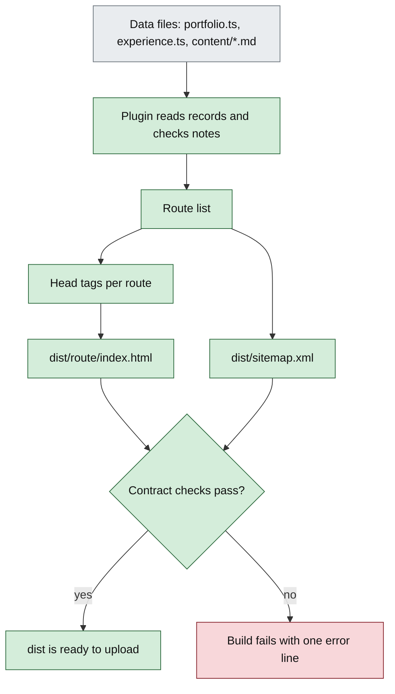
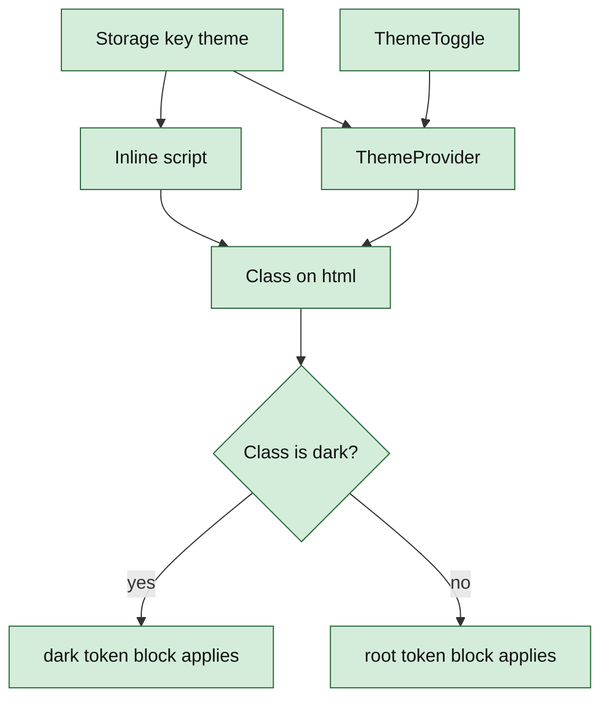
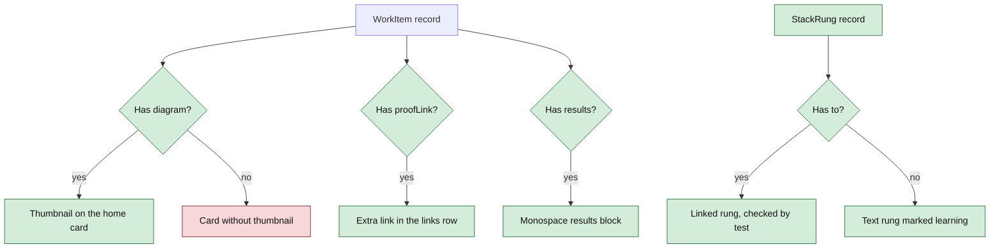
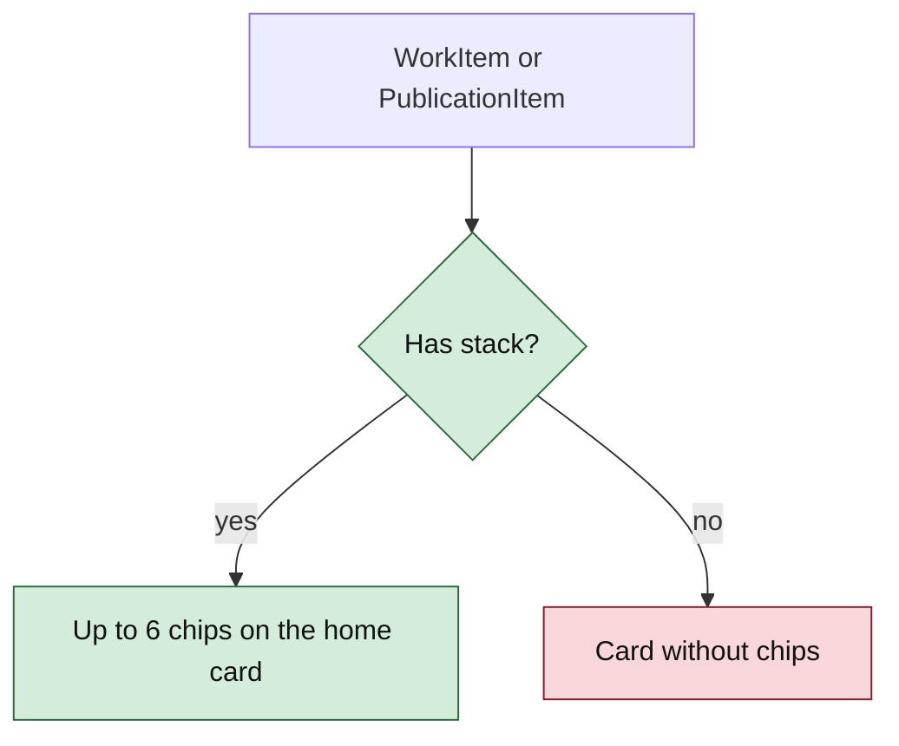
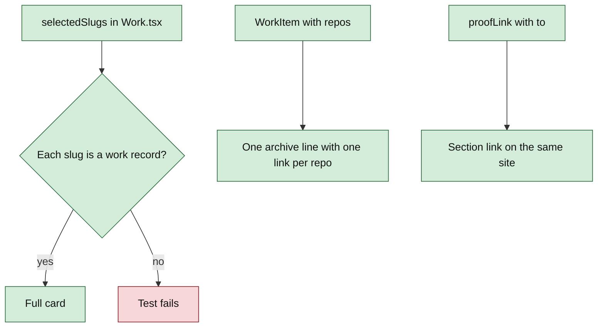

# Portfolio Content Contracts

These are local application contracts, not network APIs.

## Core types

> **Drift warning.** The types in this section describe the intended content model, not the shipped one. `src/data/portfolio.ts` implements a flatter `WorkItem` (string-literal categories, no `role`/`period`/`outcomes`/`evidence`), a three-kind `PublicationItem` without slugs or tags, and an `ActivityItem` without `id` or `category`. Reconciling the two means deciding whether to grow the code or shrink the contract, which is out of scope for the contact change. Read the code as authoritative until then.

```ts
type PublicationKind =
  | 'writing'
  | 'note'
  | 'research'
  | 'reproduction'
  | 'paper';

type PublicationStatus =
  | 'draft'
  | 'published'
  | 'submitted'
  | 'under-review'
  | 'accepted';

interface EvidenceLink {
  label: string;
  url: string;
  kind: 'github' | 'demo' | 'paper' | 'dataset' | 'slides' | 'external';
}

interface WorkItem {
  slug: string;
  title: string;
  category: 'production-ai' | 'ai-systems' | 'industrial-ai' | 'data-systems';
  summary: string;
  role: string;
  period: string;
  featured: boolean;
  tags: string[];
  outcomes: string[];
  evidence: EvidenceLink[];
  confidentialityNote?: string;
}

interface PublicationItem {
  slug: string;
  title: string;
  kind: PublicationKind;
  status: PublicationStatus;
  summary: string;
  publishedAt?: string; // ISO YYYY-MM-DD
  updatedAt?: string;   // ISO YYYY-MM-DD
  projectSlug?: string;
  tags: string[];
  evidence: EvidenceLink[];
}

interface ActivityItem {
  id: string;
  date: string; // ISO YYYY-MM-DD
  category: 'release' | 'writing' | 'research' | 'experiment' | 'milestone';
  title: string;
  summary: string;
  url?: string;
  projectSlug?: string;
}

type EmploymentType = 'full-time' | 'contract' | 'part-time' | 'internship';

interface ExperienceItem {
  id: string;
  company: string;
  title: string;
  employmentType: EmploymentType;
  location: string;
  workMode?: 'on-site' | 'hybrid' | 'remote';
  startDate: string; // ISO YYYY-MM
  endDate?: string;  // ISO YYYY-MM; absent means Present
  current?: boolean;
  summary: string;
  highlights: string[];
  skills?: string[];
  source: 'linkedin-screenshot' | 'approved-resume' | 'both';
}

interface ResumeAsset {
  label: 'Download resume';
  href: string;
  filename: string;
  updatedAt: string; // ISO YYYY-MM-DD
}
```

## Route contracts

Routes registered in `src/App.tsx` today:

```text
/#/                         Homepage
/#/work                     Work collection
/#/experience               Complete professional chronology
/#/writing                  Writing and build logs
/#/research                 Research collection
/#/notes                    Notes collection
/#/resume                   Résumé viewer
/#/*                        Not found
```

Registered (ADR-023, shipped 2026-09-23):

```text
/#/work/:slug               Case study. Resolves only when the WorkItem has `caseStudy`.
/#/experience/:slug         Case study for an employer role. Resolves only when an ExperienceItem has `caseStudy`.
/#/writing/:slug            Post. Resolves only when status is Published (any status in `vite dev`).
```

Detail routes (`/#/research/:slug`, `/#/notes/:slug`) remain unbuilt. `/#/work/:slug` and `/#/writing/:slug` are proposed above. Earlier versions of this file listed all four as though they existed. They did not. Any link written against them resolves to the not-found route. They remain the intended Phase 2 design and will be restored to this table when they are actually registered.

The homepage contact section is a scroll target within `/#/`, not a route. See ADR-012.

### Not-found contract

- Renders inside `PortfolioShell`, inheriting the site palette and navigation.
- Recovery link uses `react-router` `Link`, never a raw `href`, so it resolves under the deployed base path.
- Logs the attempted pathname once per navigation.

## Contact contract

```ts
interface ContactChannel {
  label: string;
  value: string;              // shown verbatim as page text
  href: string;               // mailto:, https:, or base-composed asset path
  copyable?: boolean;         // renders a clipboard control beside the value
}
```

Required behavior:

- `value` is rendered as readable text for every channel. It is never replaced by an icon, hidden behind an interaction, or obfuscated.
- The email channel sets `copyable`. Its copy control writes `value` — not `href` — to the clipboard.
- A resolved clipboard write shows a transient confirmation that reverts after roughly two seconds. The pending timer is cleared on unmount.
- A rejected clipboard write surfaces the failure. It is never swallowed, because a silent failure is indistinguishable from success.
- `mailto:` and clipboard are both permitted to fail without degrading the section: the visible `value` is the guaranteed path.
- External `href` values are HTTPS and carry `rel="noreferrer"` with `target="_blank"`.
- The résumé `href` is composed from `import.meta.env.BASE_URL`.

## Document asset contracts

Static metadata in `index.html`, all of which must survive being served from a subpath:

```text
link rel="icon"     base-path-composed, resolves to public/favicon.ico
og:image            absolute deployed URL to the social card
og:url              absolute deployed URL to the site root
twitter:card        summary_large_image, valid only while og:image exists
```

Required behavior:

- No URL pointing back at this site is written as a raw absolute path. It is either router-managed or composed from the Vite base.
- `twitter:card` may declare `summary_large_image` only while a reachable `og:image` exists; otherwise shares render an empty card.
- `og:url` is hardcoded to the deployed origin and must be edited if the deployment target changes.

## Homepage query contracts

```ts
getFeaturedWork(limit = 3): WorkItem[]
getRecentPublications(limit = 3): PublicationItem[]
getRecentActivity(limit = 5): ActivityItem[]
getRelatedPublications(slug: string, limit = 3): PublicationItem[]
getExperience(): ExperienceItem[]
getResumeAsset(): ResumeAsset
```

Required behavior:

- Results are deterministic.
- Date-sorted queries use descending ISO dates.
- Draft publications never appear in public recent-publication results.
- Featured work is capped at three on the homepage.
- Unknown slugs return the not-found route.
- Experience records sort by `startDate` descending and use stable IDs.
- `experiences` holds every role (J&J, iDwTeam, HP, ASU, ECrent). `resumeExperiences` filters out `linkedinOnly` records and feeds the home strip and main timeline (J&J → HP → ECrent). The "Full history" list renders all of `experiences` as one-line rows.

## Long-form content contract (ADR-023, shipped 2026-09-23)

Additions to the shipped types in `src/data/portfolio.ts`. Existing fields are unchanged.

```ts
interface WorkItem {
  // ...existing fields
  caseStudy?: string;          // slug of src/content/<slug>.md; presence enables /#/work/:slug
}

interface PublicationItem {
  // ...existing fields
  slug: string;                // unique across publications; names src/content/<slug>.md
  date?: string;               // ISO date, required when status is 'Published'
}

// src/pages/Article.tsx
loadBody(slug: string): Promise<string | null>   // raw Markdown, or null if no file matches
```

Invariants:

- Every `caseStudy` and every publication `slug` has a matching `src/content/<slug>.md`. A missing file renders NotFound and logs `console.error` in development.
- `marked` output is inserted with `dangerouslySetInnerHTML`. This is allowed only because every Markdown file is committed to this repo. Any external content source requires a sanitizer first (ADR-023).
- The nav includes Writing if and only if a Published publication exists whose kind is not `'Research note'`. It includes Research if and only if a Published `'Research note'` exists (changed 2026-10-27). The Writing list and hero proof card 2 exclude research notes. Research notes still open at `/#/writing/:slug`.
- The `Article` chunk, including `marked`, is lazy, and each Markdown body is its own chunk. Neither `marked` nor article text may land in the entry bundle. Measured at ship: entry +0.3 kB gz (route definitions and card links), `Article` chunk 14.9 kB gz, each body ~2 kB gz. (Note: the entry bundle already exceeds its 65 kB budget at ~107.7 kB gz, because the cleanup in ADR-020 has not shipped. This change neither fixes nor worsens that.)
- Case-study text follows the confidentiality boundary in `architecture.md`. No internal system, team, or metric names. No numbers beyond the published résumé without Saketh's confirmation.

Error shape: there is no error UI beyond NotFound. A failed chunk load (e.g. network drop mid-navigation) also resolves to NotFound rather than a blank page.

## Content validation rules

- Every slug and activity ID is unique.
- Every public artifact has a title, summary, date, and honest type/status.
- `accepted` requires a public venue or evidence link.
- `submitted` and `under-review` must never be styled as accepted.
- Employer-confidential work cannot link to private material or disclose restricted implementation details.
- External URLs use HTTPS except local development URLs.
- Activity events describe an outcome, not a number of commits.
- Every experience record requires title, organization, employment type, start/end dates, location, and source provenance.
- Internship records require the same evidence and are not inferred from education or project work.
- Resume href resolves under the deployed Vite base path and the asset is a readable PDF.

## Future optional build input

If GitHub-assisted activity is added, its adapter may accept:

```ts
interface GitHubReleaseInput {
  repository: string;
  tag: string;
  name: string;
  publishedAt: string;
  url: string;
  description?: string;
}
```

The adapter output remains a draft `ActivityItem`; it must not bypass review and publish directly.

## Visual upgrade contracts (proposed 2026-09-22)

### Site constants

Removes the duplicated URL literals. It is the single source for every outbound link the shell, hero, and contact section render.

```ts
// src/data/site.ts
export const site = {
  name: 'Saketh Velidimalla',
  role: 'Applied AI Systems Engineer',
  email: 'sakethv7@gmail.com',
  github: 'https://github.com/Sakethv7',
  linkedin: 'https://www.linkedin.com/in/sakethvelidimalla/',
  resume: {
    href: `${import.meta.env.BASE_URL}Saketh_Velidimalla_Resume.pdf`,
    filename: 'Saketh_Velidimalla_Resume.pdf',
  },
} as const;
```

Invariants: `resume.href` is composed from `BASE_URL` (ADR-014). External URLs are HTTPS. No component builds these strings itself.

### BentoTile

```ts
type TileVariant = 'identity' | 'now' | 'metric' | 'flagship' | 'project' | 'thesis' | 'experience' | 'resume';

interface BentoTileProps {
  variant: TileVariant;        // selects grid-area and variant styling
  as?: 'article' | 'section' | 'div';   // default 'article'; identity uses 'section' containing the page h1
  labelledBy?: string;         // id of the tile's heading, for aria-labelledby
  children: React.ReactNode;
}
```

Renders `<{as} class="bento-tile" data-tile={variant} aria-labelledby={labelledBy}>`, with a decorative `::before` spotlight layer.

Invariants:

- Exactly one `h1` exists on the page, inside the `identity` tile.
- Tile headings are `h2` (grid-level) or `h3`. No heading levels are skipped.
- The whole tile is not a link. Links inside tiles are ordinary anchors, so a tile with two links (repo and case study) stays unambiguous to screen readers.
- `variant` maps 1:1 to a `grid-area` name. Adding a variant means adding an area at all three breakpoints.

### useSpotlight

```ts
function useSpotlight<T extends HTMLElement>(): React.RefObject<T>;
```

Attach the returned ref to the grid container.

Behavior contract:

- Registers one `pointermove` listener on the container. It never adds a per-tile listener.
- On move, it finds `event.target.closest('[data-tile]')` and sets `--mx` and `--my` on that element, in pixels relative to its bounding box.
- It does nothing when `matchMedia('(hover: none)')` matches.
- It removes the listener on unmount.
- It never calls React `setState`. Pointer movement must not re-render.

### Design tokens

```css
/* src/styles/tokens.css — ratio ≈ 1.25, base 1rem */
:root {
  --step--2: 0.75rem;                          /* eyebrow, meta, tags */
  --step--1: 0.875rem;                         /* secondary body — floor for readable text */
  --step-0:  1rem;                             /* body */
  --step-1:  1.25rem;                          /* h3, tile titles */
  --step-2:  1.5625rem;                        /* large tile titles */
  --step-3:  clamp(1.75rem, 1.2rem + 2.2vw, 2.5rem);   /* h2 small */
  --step-4:  clamp(2.25rem, 1.4rem + 3.6vw, 3.75rem);  /* h2 */
  --step-5:  clamp(3rem, 1.6rem + 6vw, 6rem);          /* h1 */

  --space-1: 4px;  --space-2: 8px;  --space-3: 12px; --space-4: 16px;
  --space-5: 24px; --space-6: 32px; --space-7: 48px; --space-8: 64px;
  --space-9: 96px; --space-10: 128px;

  --radius-tile: 14px;
  --tile-row: 168px;
  --grid-gap: var(--space-4);

  --ease-out: cubic-bezier(.22, 1, .36, 1);
  --dur-fast: 160ms; --dur-base: 240ms; --dur-enter: 480ms;

  --font-display: 'Newsreader', Georgia, serif;   /* pending typeface decision */
  --font-body: Inter, ui-sans-serif, system-ui, sans-serif;
  --font-mono: ui-monospace, 'SF Mono', Menlo, monospace;
}
```

Invariants:

- No `font-size` below `--step--2`. Running text is never below `--step--1`.
- Negative letter-spacing applies only at `--step-3` and above. At small sizes, tight tracking hurts legibility.
- Every `margin`, `padding`, and `gap` in `index.css` uses a `--space-*` token. Exceptions are 1px borders and optical nudges ≤ 3px.

### Motion contract

| Selector / attribute | Effect | Reduced motion |
|---|---|---|
| `.enter` + `style="--i:n"` | stagger entrance, delay `n × 60ms` | none, final state |
| `.reveal` | scroll-linked fade/rise, only inside `@supports (animation-timeline: view())` | none |
| `.bento-tile::before` | spotlight at `--mx/--my` | still shown (not motion; follows pointer) |
| `a:has(> svg.lucide-arrow-right):hover svg` | `translateX(3px)` | none |
| `[data-tile="now"] .live-dot::after` | opacity/scale pulse, infinite | static dot |

### Performance budget contract

Checked after `vite build`, against the gzip column:

- `assets/index-*.js` ≤ 65 kB
- `assets/index-*.css` ≤ 8 kB
- At most 2 web-font families, and every family loaded is referenced by a token.
- 0 infinite animations on paint-triggering properties.

A change that breaks the budget either updates this table with its reasoning in an ADR, or doesn't ship.

### Résumé route (proposed, ADR-021)

```text
/#/resume        Résumé viewer — inside PortfolioShell, lazy-loaded chunk
```

- Embeds the résumé URL (composed from `BASE_URL`) via `<object data type="application/pdf">`. The fallback children are an "Open PDF" and a "Download" link, so a blocked embed never renders blank.
- Below 768px it does not render the `<object>`; it renders the fallback card only.
- The header's `Download résumé` link stays a direct download. "Résumé" is not added to the primary nav (ADR-012's slot argument applies). The route is reached from the hero, the Experience CTA, and the contact section via a "View résumé" link.

## Plain-language contracts (proposed 2026-10-05, ADR-025 to ADR-028)

### Visual Level



*Caption: green is new. The record must hold a `plain` string or the build fails (red). Both texts then render, in order.*

Contracts below are written against the **shipped** types in `src/data/portfolio.ts`, not the intended model in "Core types" above. See the drift warning there.

### Type change

```ts
interface WorkItem {
  // ...existing fields
  plain: string;   // required. One sentence for a non-technical reader.
}

interface PublicationItem {
  // ...existing fields
  plain: string;   // required. Same rule.
}
```

`summary` and `tags` keep their meaning. `summary` is now the technical description, for engineers.

### Content rules for `plain`

| Rule | Check |
|---|---|
| One sentence, 25 words or fewer | Review, `ste-lint` |
| No technology list, no acronym a layperson would not know | Review |
| No semicolons, no em-dash chains | `ste-lint` |
| No internal system, team, or metric name | Review (confidentiality boundary in `architecture.md`) |
| A number or outcome only if on the résumé or confirmed by Saketh | Review |
| Not an empty string | Review. Not enforced by the type. |

### Rendering contract

Every surface that shows an item renders in this order: `plain`, then a label with the exact text `For engineers`, then `summary`, then (for cards and rows) `tags`, then links.

| Surface | Reads | Class names |
|---|---|---|
| Home featured card | `WorkItem.plain`, `.summary`, `.tags` | `.plain-line`, `.for-engineers` |
| Work archive row | same | same |
| Writing list row | `PublicationItem.plain`, `.summary` | same |
| Article header | record `plain` and `summary` | `.plain-line` (lead), `.for-engineers` |

`findRecord` in `Article.tsx` returns `plain` alongside `title`, `eyebrow`, and `summary`. It returns the same field for both collections.

Both texts are always in the DOM and always visible. Nothing is collapsed, so screen readers and print see both. The label is a visible text element, not a tooltip.

### Meta tags

`index.html` `description` and `og:description` use plain words and no mention of industrial machines or edge compute (ADR-027). Both are 160 characters or fewer. Per-article previews remain impossible under HashRouter (see architecture open questions), so the home page's tags carry every shared link.

### Invariants

- Every `WorkItem` and every `PublicationItem` has a non-empty `plain`. The type enforces presence only.
- `plain` and `summary` describe the same thing at two levels. If one changes meaning, the other changes in the same edit.
- No new route, dependency, or fetch. The bundle budget in the performance contract is unchanged. The added cost is about 37 short strings and a few CSS rules.
- Article Markdown bodies are not modified, except one "In one paragraph" quote at the top of `enterprise-ai-quality.md`.
- `plain` follows the confidentiality boundary in `architecture.md`. It adds no numbers beyond the published résumé.

### Error shape

A missing `plain` is a TypeScript compile error, for example `Property 'plain' is missing in type`. There is no runtime error and no error UI.

### Validation additions

Append to "Content validation rules":

- Every work item and publication has a `plain` sentence of 25 words or fewer.
- `og:description` and `description` match the hero's plain claim.
- The hero, `description`, `og:description`, and contact intro do not mention industrial machines or edge compute. The agentic-maintenance Work row and build log may.

## Proposed evidence-status extension

```ts
type EvidenceStatus =
  | 'Production / enterprise'
  | 'Public prototype'
  | 'Experimental / public-data validation';
```

`evidenceStatus` is display metadata, populated from verified project evidence. It is never inferred from repository visibility, tags, or marketing copy.

## Hero proof card and primary action contracts (proposed 2026-10-27, ADR-031 to ADR-033)

### Visual Level



*Caption: green is new. Three existing data sources go in, and an array of up to three cards comes out. Red is the omit path. The array never holds a placeholder.*

Contracts are written against the shipped types in `src/data/portfolio.ts` and `src/data/experience.ts`.

### Type

```ts
// src/data/proof.ts
export interface ProofCard {
  id: 'production' | 'writing' | 'app';
  claim: string;        // plain, 12 words or fewer, may hold a derived count
  evidence: string;     // one short line: scale, newest title, or evidence status
  linkLabel: string;    // visible action text, e.g. 'Read the case study'
  to?: string;          // internal route, for react-router Link
  href?: string;        // external https URL
  image?: { src: string; alt: string; width: number; height: number };  // card 3 only; src composed from BASE_URL
}

export const heroProof: ProofCard[];   // 0 to 3 cards, in the order production, writing, app
```

Exactly one of `to` and `href` is set. `to` renders as a router `Link`, so it resolves under the deployed base path (ADR-014). `href` renders as an anchor with `target="_blank"` and `rel="noreferrer"`.

### Card sources

| `id` | Source | Required field | `claim` | `evidence` |
|---|---|---|---|---|
| `production` | `experiences.find(e => e.caseStudy?.slug === 'enterprise-ai-quality')` | `caseStudy.slug` | `I work on evals, observability, red-teaming, guardrails, and data and vector schemas for a production RAG platform` | `The platform serves about 140,000 employees` (résumé figure) |
| `writing` | `publications.filter(p => p.status === 'Published')` | length ≥ 1 | `` `${n} engineering notes on evaluation, retrieval, and tracing` `` | `Newest: ${title}`, newest by `date` |
| `app` | `work.find(w => w.slug === 'sakethwiki')` | `github` | `A knowledge app I use daily: capture, chat, review, browse` | `SakethWiki, ${evidenceStatus}`. Image: `public/proof/sakethwiki.webp` |

### Rendering contract

```html
<section class="hero editorial-section hero-grid">
  <div class="hero-copy">eyebrow · h1 · thesis · actions</div>
  <ul class="proof-list" aria-label="Evidence">
    <li><a class="proof-card" …>
      <span class="proof-claim">…</span>
      <span class="proof-evidence">…</span>
      <span class="proof-link">linkLabel →</span>
    </a></li>
  </ul>
</section>
```

- Each card is one link. A card has one destination, so the whole card can be the link. This differs from the BentoTile rule in this file, which applies to tiles with two links.
- The link's accessible name is its visible text: claim, evidence, then link label.
- When `heroProof` is empty, the `ul` is not rendered and `.hero-grid` falls back to one column.
- Card text has no heading element. The page keeps one `h1`, and the next heading stays the first section `h2`.

### Primary action contract

```ts
// src/pages/Index.tsx
type HeroAction =
  | { style: 'filled'; label: 'Get in touch'; scrollTo: 'contact' }
  | { style: 'outlined'; label: 'View résumé'; to: '/resume' }
  | { style: 'link'; label: 'GitHub'; href: 'https://github.com/Sakethv7' };
```

This type documents the contract. The code does not need to declare it.

- The hero holds exactly one filled button (`primary-link`) and one outlined button (`secondary-button`).
- "Get in touch" scrolls to `#contact`, where the email shows as text. It never opens `mailto:` directly (ADR-013). It prevents the default hash navigation, as the current Contact link does.
- "View résumé" is a router `Link` to `/resume`.
- Scroll behavior is `'auto'` when `matchMedia('(prefers-reduced-motion: reduce)').matches`, else `'smooth'`.
- GitHub uses a plain text link style.

### Invariants

- `heroProof` has 3 cards or fewer. It never holds a card whose source record is missing.
- The `writing` count is derived from `publications`. It is never typed by hand.
- The 140,000 figure equals the figure on the published résumé. No other number appears on a card unless Saketh confirms it (copy rule 3).
- No card names the internal assistant, a team, or an internal metric (copy rule 5).
- No new route, dependency, fetch, or client state. `proof.ts` adds a few hundred bytes to the entry bundle.
- The card 3 image has fixed `width` and `height`, `loading="lazy"`, and a non-empty `alt`. It is 100 kB or less and shows no private notes.

### Error shape

There is no runtime error UI. A missing source record omits its card. In development it also logs `console.warn('heroProof: missing <id> source')`. A wrong field type is a TypeScript compile error.

### Validation additions

Append to "Content validation rules":

- Every proof card claim is 12 words or fewer. Every evidence line is 8 words or fewer, except the `writing` card, which shows the newest note title in full.
- Every number on a proof card is on the résumé or confirmed by Saketh.
- Every proof card link resolves: internal routes match a registered route, and external URLs answer over HTTPS.

---

## Writing page merge (ADR-034, proposed 2026-11-05)

### Visual Level



*Caption: green is the new contract. Red is the fallback for a bad value.*

### Routes

| Route | Before | After |
|---|---|---|
| `/writing` | `Collection type="writing"` | `Collection`. Reads `?kind=`. |
| `/research` | `Collection type="research"` | `<Navigate to="/writing?kind=research" replace />` |
| `/notes` | `Collection type="notes"`, always empty | Removed, if Saketh agrees (open question) |
| `/writing/:slug` | Article | No change |

### Query contract

`kind` is optional. Allowed values, matched to `PublicationItem['kind']`:

| Value | Matches |
|---|---|
| (absent) | All published notes |
| `engineering` | `Engineering note` |
| `research` | `Research note` |
| `system-design` | `System design` |
| `build-log` | `Build log` |

An unknown value behaves as absent. No error shows.

### Signature change

`Collection({ type })` becomes `Collection()`. The `descriptions` map has one entry for Writing. The page text says it holds engineering notes, research notes, system design and build logs.

### Invariants

- The nav shows Writing when at least one note is Published. `hasPublishedResearch` is removed. `hasPublishedWriting` becomes "any note is Published".
- A chip shows only when its kind has a Published note.
- `noteCounts` stays. The Work header and the home proof card still read it. Their `/writing` links may add `?kind=`.
- Every note keeps its URL `/writing/:slug`.
- The series order still follows the project's `notes` list in `portfolio.ts`.
- No new dependency. `useSearchParams` and `Navigate` come from `react-router-dom`.

---

## Trim home and Work (ADR-035 to 037, proposed 2026-11-05)

### Visual Level



*Caption: green marks each contract change. All are type changes in `portfolio.ts` and `proof.ts`.*

### Type changes

| Type | Before | After |
|---|---|---|
| `ActivityItem` | `date, title, summary, href?` | adds `series?: string`, the same value as `PublicationItem.series` |
| `ProofCard['id']` | `'production' \| 'writing' \| 'research' \| 'app'` | `'production' \| 'research' \| 'app'` |
| `noteCounts` | `total, research, engineering, systemDesign, buildLog` | `research` only |

### Invariants

- The four benchmark entries in `activity` set `series: 'GEO agent benchmark'`.
- Home shows at most 4 activity entries, none with that series.
- `heroProof` has 3 cards or fewer.
- Every cut topic in the hero text has a topic link or a Selected work card.
- Work shows Flagship systems and Developer tools open. It shows Experiments & learning and Creative builds inside a closed `<details>`.
- No new dependency, route or script.

## Article reading aids and diagrams (ADR-042 to 046, proposed 2026-11-17)

### Visual Level



*Caption: green marks each new contract. No existing type changes.*

### New function: `prepareArticle`

File: `src/lib/article.ts`. It imports only `marked`. It must not import through the `@/` alias, so `node --test` can load it.

```ts
export interface Heading { id: string; text: string; level: 2 | 3 }

export interface PreparedArticle {
  html: string;          // heading elements carry ids and an anchor link
  headings: Heading[];   // document order, h2 and h3 only
  minutes: number;       // integer, 1 or more
}

export function prepareArticle(markdown: string, basePath: string): PreparedArticle
```

Rules:

- A leading `# Title` line is removed first, as today.
- `id` is the lowercase heading text, with each run of non-letters and non-digits turned into one `-`, and the ends trimmed. An empty result becomes `section`. A repeated id gets `-2`, `-3` and so on. Ids are unique per article.
- Each `h2` and `h3` becomes `<h2 id="x">Text <a class="heading-anchor" href="#/{basePath}?section=x" aria-label="Link to this section">#</a></h2>`. Link text is not part of `Heading.text`.
- `h1` and `h4` to `h6` get no id and are not listed.
- `minutes` is `max(1, ceil(words / 230))`. `words` counts words outside fenced code blocks. 230 is an assumption (see the open questions in `architecture.md`).
- The function is pure. The same input gives the same output.
- `html` is trusted for the same reason as before: every Markdown file is committed to this repo (ADR-023). Heading text is escaped when it goes into an attribute.

### New component: `ArticleContents`

```ts
function ArticleContents(props: { headings: Heading[]; basePath: string }): JSX.Element | null
```

- Returns `null` when `headings.filter(h => h.level === 2).length < 3`.
- Each entry is a router `Link` to `{ pathname: basePath, search: '?section=' + id }`.
- At 1100 px and wider it is a sticky aside. Below that, it is a `<details>` element, closed, with the summary "Contents".
- `h3` entries are indented under their `h2`.

### New helper: `endLinks`

File: `src/data/portfolio.ts`.

```ts
export interface EndLinks { label: 'Next in this series' | 'More notes'; items: PublicationItem[] }

export function endLinks(slug: string): EndLinks | null
```

- Considers only `status === 'Published'` records.
- Series rule and fallback rule are in `logic_flow.md`.
- `items` has 1 or 2 entries. It never includes the note itself.
- Returns `null` if the slug is unknown or no other published note exists.

### Route contract change

| Route | Before | After |
|---|---|---|
| `/writing/:slug`, `/work/:slug`, `/experience/:slug` | no query | accepts optional `?section=<heading id>` |

An unknown `section` value is ignored.

### Figure contract for Markdown

```html
<figure class="diagram">
  <a href="diagrams/<name>.svg" target="_blank" rel="noopener">.svg" alt="<what the diagram shows>" width="<w>" height="<h>"></a>
  <figcaption>One sentence that says what to look at.</figcaption>
</figure>
```

Invariants:

- Every `diagrams/<name>.svg` named in a content file exists in `public/diagrams/`.
- Every figure image has a non-empty `alt` that states the reading, not only the topic. It also has `width` and `height`, so the page does not jump while it loads.
- Every number in a diagram appears in the note's text. A diagram adds no new claim (project copy rule 3).
- Diagrams use only the site palette. The site is dark only, so each SVG has a dark background or a transparent one that reads on the dark page.
- No Markdown diagram library is added to the bundle.

### Invariants for the whole change

- No new dependency. No new route. No change to any existing type.
- `Article` chunk growth stays small. I will report the gzipped size before and after.
- A content test fails if a figure file is missing or an `alt` is empty.

---

# Change 2026-11-19: contracts for ADR-047 to ADR-050 (revision 2)

## Visual Level



*Caption: grey exists today, green is new, red is the failed-check path. The data files are the only input. The `dist/` files are the only output. The static files hold head tags only.*

## Route table

Base path: `/sakethai-portfoliogen/`. Every route ends with `/`.

| Route | Source | File written |
|---|---|---|
| `/` | home | `index.html` (head tags replaced) |
| `/work/` | page | `work/index.html` |
| `/work/<slug>/` | `work` records with a `caseStudy` value. The Markdown file is `<caseStudy>.md`. | `work/<slug>/index.html` |
| `/experience/` | page | `experience/index.html` |
| `/experience/<slug>/` | `experiences` records whose `caseStudy.slug` is set (as `Article.tsx` matches today) | `experience/<slug>/index.html` |
| `/writing/` | page | `writing/index.html` |
| `/writing/<slug>/` | `publications` with `status: 'Published'`. Planned and in-progress records get no route. | `writing/<slug>/index.html` |
| `/resume/` | page | `resume/index.html` |
| `/research/` | React redirect to `/writing/?kind=research` | `research/index.html` (status 200, then React redirects) |
| any other | none | `404.html`, status 404, with `noindex` |

The `?kind=`, `?tag=` and `?section=` values are never routes. They do not get files.

Old to new: `/#/<path>?<query>` maps to `/<path>/?<query>`. The slash goes before the `?`. Internal `<Link>` values may omit the trailing slash. GitHub Pages is expected to redirect them (untested, see `architecture.md` open question 3). The canonical address always has the slash.

## Data contract

`PublicationItem` gains one optional field. `tags` was added in PR #4.

```ts
interface PublicationItem {
  // existing fields unchanged
  tags?: string[];   // 2 to 4 labels, each written one way (exact case)
  pin?: number;      // 1, 2 or 3. At most three records have a pin. Unique values.
}
```

Invariants, checked by tests:

1. No two tags differ only by case. No separate tag list exists. The tag set comes from the records.
2. At most three records have `pin`. The values are unique and between 1 and 3.
3. A pinned record has `status: 'Published'`.
4. Every record that has a route and a Markdown body (note, case study, experience study) has its file in `src/content/`.

## Head tags per route

| Tag | Value | Limit |
|---|---|---|
| `<title>` | `<record title> \| Saketh Velidimalla`. Home keeps its current title. `404.html` keeps the home title and adds `<meta name="robots" content="noindex">`. | none |
| `meta description` and `og:description` | The `plain` sentence. Home keeps its current text. | Warn above 160 characters. Error above 200. |
| `link rel=canonical` and `og:url` | `https://sakethv7.github.io/sakethai-portfoliogen<route>` | Absolute, with trailing `/` |
| `og:title`, `twitter:title` | Same as `<title>` | none |
| `og:image`, `twitter:image` | `/og-image.png` (shared) | 1200 by 630 |
| `og:type` | `article` for a note. `website` for others. | none |

The plugin replaces existing tags. It never adds a second tag of the same name.

## sitemap.xml

```xml
<?xml version="1.0" encoding="UTF-8"?>
<urlset xmlns="http://www.sitemaps.org/schemas/sitemap/0.9">
  <url><loc>https://sakethv7.github.io/sakethai-portfoliogen/writing/<slug>/</loc><lastmod>YYYY-MM-DD</lastmod></url>
</urlset>
```

`lastmod` appears only when the record has a `date` or `updated` value. The list has exactly one `<url>` for each route in the route table, and none for `404.html`.

`robots.txt` gains one line: `Sitemap: https://sakethv7.github.io/sakethai-portfoliogen/sitemap.xml`. The existing rules stay. Crawlers read `robots.txt` only at the host root (`https://sakethv7.github.io/robots.txt`), so this line may be ignored. Saketh submits `sitemap.xml` in Google Search Console and Bing Webmaster Tools.

## Plugin contract

| | |
|---|---|
| Where | A Vite plugin in `vite.config.ts`, hook `closeBundle`. No new dependency. |
| Reads | `src/data/portfolio.ts` and `src/data/experience.ts` (not `proof.ts`, which reads `import.meta.env.DEV`), `src/content/*.md`, `dist/index.html`, `dist/robots.txt` |
| Base path | From the Vite config, so `vite build` and `vite build --mode development` give correct paths |
| Writes | files under `dist/` only |
| Network | none |
| Result | The build passes, or fails with one error line |

Error shapes: one line each, no stack trace. The line starts with `prerender:`.

```
prerender: missing note file for slug "<slug>"
prerender: description too long (<n> characters) for "<slug>"
prerender: route count <r> does not match file count <f>
```

## Client contract

1. `BrowserRouter` takes `basename` from `import.meta.env.BASE_URL`.
2. `index.html` has one inline script in `<head>`. It runs only if `location.hash` starts with `#/`. It calls `history.replaceState(null, '', base + hash.slice(2))` where the path ends with `/`.
3. `main.tsx` keeps `createRoot`. `#root` is empty in every static file.
4. `Writing` reads `?tag=` and URL-decodes it. A value that matches no tag is ignored. A pill is a link to `?tag=<encoded name>`, with `kind` kept. While a tag is active, series cards are not shown.
5. `prepareArticle` rewrites a Markdown link `#/<path>` to `<base><path>/`, and builds heading links as `<path>?section=<id>`. A test checks that no `#/` remains in rendered note HTML.
6. A click handler on `.article-body` sends same-site links to `navigate()`. It ignores clicks with a modifier key and links with a different origin.
7. The `HashRouter` comments in `App.tsx` and `src/lib/article.ts` are updated.
8. `prepareArticle(markdown, basePath, siteBase)` also rewrites every relative `src` and `href` in the rendered note (such as `diagrams/x.svg`) to `<siteBase>` plus the path. Reason: a note page is `/writing/<slug>/`, so a relative path no longer reaches the site root. A test checks that none remain.
9. `usePageTitle(page)` sets `document.title` to `<page> | Saketh Velidimalla`, or the home title when `page` is empty. Each page calls it. Reason: a client-side move does not load a new static file.

## Unchanged

The `?section=` value, the reading aids, and the tag pill look (ADR-042 to ADR-046 and PR #4).

## Open contract questions

1. The home page `#contact` link logic (api.md, "Get in touch") stopped being needed once routing leaves the hash. Leave it as is, or remove it. This draft leaves it.
2. The `plain` sentence for the four GEO records is over 160 characters. Warn, or shorten them in this change.
3. `Collection.tsx` shows Planned items when `import.meta.env.DEV` is true. The plugin ignores them, so a Planned item has a card in dev and no page in production.

## Theme contract (ADR-051, proposed 2026-11-19)

### Visual Level



*Caption: green is new. The contract has one shared key and one shared class. Every other piece reads one of them.*

### Shared state

| Name | Type | Values | Owner |
|---|---|---|---|
| `localStorage["theme"]` | string | `"light"`, `"dark"`. Any other value or no value means "no choice". | Written by `next-themes`. Read by the script and the provider. |
| `html` class | string | `"light"` or `"dark"`. | Set by the script first, then by `next-themes`. |

Invariant: after the script runs, the `html` class is always one of the two values. The `dark` class selects the `.dark` token block. Any other class selects the `:root` block.

### Provider

```tsx
<ThemeProvider attribute="class" defaultTheme="system" storageKey="theme" enableSystem disableTransitionOnChange>
```

`defaultTheme` follows open question 1 in `architecture.md`. `disableTransitionOnChange` stops a half-second color fade on every element during a swap.

### Component

```ts
// src/components/ThemeToggle.tsx
export default function ThemeToggle(): JSX.Element
```

Takes no props. Renders one `<button type="button">`. Its `aria-label` names the action: "Switch to light theme" when dark, "Switch to dark theme" when light. Before `next-themes` knows the theme (first client render), it renders a button of the same size with no icon, so the header does not shift.

### Tokens

Same names as today. Dark values do not change. Light values below are targets, checked by the contrast test.

| Token | Dark (today) | Light (proposed) |
|---|---|---|
| `--background` | `222 33% 5%` | `40 25% 97%` |
| `--foreground` | `42 20% 92%` | `222 33% 10%` |
| `--card`, `--popover` | `222 25% 8%` | `0 0% 100%` |
| `--card-foreground`, `--popover-foreground` | `42 20% 92%` | `222 33% 10%` |
| `--primary`, `--ring` | `263 74% 70%` | `263 60% 45%` |
| `--primary-foreground` | `222 33% 5%` | `0 0% 100%` |
| `--secondary`, `--muted` | `222 18% 13%` | `40 15% 92%` |
| `--secondary-foreground` | `42 20% 92%` | `222 33% 10%` |
| `--muted-foreground` | `218 12% 65%` | `220 10% 38%` |
| `--accent` | `186 55% 55%` | `186 70% 28%` |
| `--accent-foreground` | `222 33% 5%` | `0 0% 100%` |
| `--destructive` | `0 70% 50%` | `0 72% 45%` |
| `--destructive-foreground` | `42 20% 92%` | `0 0% 100%` |
| `--border`, `--input` | `220 14% 18%` | `40 10% 84%` |

New in each block: `color-scheme: light` (in `:root`) and `color-scheme: dark` (in `.dark`). This makes scrollbars and form controls match.

### Contrast test

File: `tests/themeContrast.test.ts`. It reads both token blocks from `src/index.css`.

| Check | Minimum ratio |
|---|---|
| `foreground` on `background`, `card`, `secondary` | 4.5 |
| `muted-foreground` on `background`, `card`, `secondary` | 4.5 |
| `primary` on `background` and `card` (used as link and label text) | 4.5 |
| `primary-foreground` on `primary` | 4.5 |
| `accent-foreground` on `accent` | 4.5 |
| `destructive-foreground` on `destructive` | 4.5 |

Error shape: the test names the theme, the token pair and the measured ratio.

### Unchanged

Route addresses, head tags, the sitemap, the page-title hook, and every content API.

### Open contract questions

1. Whether `--code-bg` and `--code-fg` become new tokens (architecture open question 3).
2. Whether the pair `primary` on `secondary` also needs a check. Some tags use that pair.

## Home page thread contracts (ADR-053 to ADR-058, proposed 2026-11-19)

### Visual Level



*Caption: green is new. Red is the fallback when a field is absent, and the card still draws. `WorkItem` exists today. The three fields and `StackRung` are new.*

### Type changes in `src/data/portfolio.ts`

```ts
export interface WorkItem {
  // ...existing fields unchanged
  diagram?: { src: string; alt: string; width: number; height: number }; // src is relative to BASE_URL, e.g. 'diagrams/system-overview.svg'
  proofLink?: { label: string; to?: string; href?: string };            // exactly one of to or href
  results?: string[];                                                    // 1 to 4 lines, each 80 characters or fewer
}
```

`width` and `height` come from the SVG `viewBox`, so the browser reserves space and the page does not shift.

### Record changes

| Record | Field | Value |
|---|---|---|
| `geo-agent-bench` | `diagram` | `diagrams/system-overview.svg`, 1000 × 660 |
| `geo-agent-bench` | `proofLink` | `{ label: 'Findings', href: 'https://github.com/Sakethv7/geo-agent-bench/blob/master/FINDINGS.md' }` |
| `geo-agent-bench` | `results` | The four lines in ADR-058 |
| `geo-agent-bench` | `summary` | The scope line in ADR-056 |
| `sakethwiki` | `diagram` | `diagrams/sakethwiki-two-paths.svg`, 900 × 650 |
| `sakethwiki` | `proofLink` | `{ label: 'System design', to: '/writing/sakethwiki-system-design' }` |
| `sakethwiki` | `plain` | The plain line in ADR-056 |
| `lekhni` | `featured` | `true` |
| `lekhni` | `github` | `https://github.com/Sakethv7/lekhni-app` |
| `lekhni` | `diagram` | `diagrams/lekhni-recording-path.svg`, 900 × 740 |
| `lekhni` | `plain` | The plain line in ADR-056 |
| `sdlc-intelligence-agent` | `featured` | removed |

Lekhni keeps `private: true`, because its main repository is private. Its `github` link goes to `lekhni-app`, a local LLM meeting-notes taker, and the label stays "Repository". The card link code needs no change for this.

### New records in `src/data/proof.ts`

```ts
export interface StackRung {
  layer: 'Product' | 'Agents' | 'Models' | 'Runtimes' | 'Network' | 'Hardware';
  work: string;               // 8 words or fewer
  to?: string;                // an internal route; absent means nothing is published yet
  mark?: 'depth today' | 'learning';
}
export const stackLadder: StackRung[]; // the six rows in ADR-054, top to bottom
export const homeRoleLine: string;     // the J&J row sentence in ADR-055
```

The proof card text in `productionCard`, `researchCard` and `appCard` changes to the copy in ADR-055. Their shape (`ProofCard`) does not change.

### Note diagrams for the research block

```ts
// src/pages/Index.tsx, local to the home page
const noteDiagrams: Record<string, WorkItem['diagram']>; // keyed by publication slug
```

Keys: `system-one-guard-for-rag` → `system-one-guard-flow.svg` (900 × 690), `calibrate-your-llm-judge` → `judge-calibration-loop.svg` (900 × 960), `retrieval-vs-generation-failures` → `retrieval-vs-generation.svg` (900 × 700). It is local because only the home page uses it. If a second page needs it, it moves to `PublicationItem`.

### Invariants

1. Every `StackRung.to` resolves to a published publication, a work record or an experience case study. A test checks this.
2. Exactly one rung has `mark: 'depth today'`, and it is the first. The last rung has `mark: 'learning'` and no `to`.
3. Every `diagram.src` names a file that exists in `public/`. A test checks this.
4. Each `results` line is 80 characters or fewer. A test checks this.
5. At most three work records have `featured: true`.
6. No home copy names an internal system or team (copy rule 5).

### Unchanged

`ProofCard`, `PublicationItem`, `ActivityItem`, the routes, and the head tags of every page except home.

### Open contract questions

1. Should `results` move into the GEO repository as a JSON file the site reads at build time? That removes the second copy (ADR-058, given up item 1). It also adds a build-time network fetch. Proposal: not now.

## Stack list on home cards (ADR-059, proposed 2026-11-19)

### Visual Level



*Caption: green is new. Red is the fallback when the field is absent.*

```ts
// Added to both WorkItem and PublicationItem in src/data/portfolio.ts
stack?: string[]; // 1 to 6 entries, each 40 characters or fewer, each named in the note or repository
```

**Invariants:** at most 6 entries, each 40 characters or fewer, no duplicates in one list. `tests/home-thread.test.mjs` checks the count and length. Nothing checks that a note names each tool. The author checks that at review. `stack` does not feed the `/writing` tag filter.

## Work page contracts (ADR-060 to ADR-062, proposed 2026-11-19)

### Visual Level



*Caption: green is new. Red is the failure path.*

### Type changes in `src/data/portfolio.ts`

```ts
export type WorkCategory = 'Flagship systems' | 'Developer tools' | 'Experiments & learning' | 'Automations & creative builds';
export interface WorkItem {
  // ...existing fields
  repos?: { label: string; href: string }[]; // archive line links when one record covers several repositories
}
```

`'Creative builds'` is renamed. No record keeps the old value.

### New constant in `src/pages/Work.tsx`

```ts
const selectedSlugs = ['geo-agent-bench', 'rag-mini', 'sakethwiki', 'lekhni', 'sdlc-intelligence-agent'];
```

### Record changes

| Record | Field | Value |
|---|---|---|
| `geo-agent-bench` | `proofLink` | `{ label: 'Seven findings', to: '/work/geo-agent-bench?section=seven-findings' }` |
| `rag-mini` | `plain`, `evidenceStatus`, `diagram`, `stack` | As in ADR-060 |
| `sdlc-intelligence-agent` | `plain`, `diagram`, `stack` | As in ADR-060 |
| `sakethwiki` | `updated` | `'2026-10-08'` |
| `roastrank` | `category` | `'Experiments & learning'` |
| `ai-digest` | `category` | `'Automations & creative builds'` |
| `classical-ml-lab`, `ml-foundations`, `neurons-background` | removed | Replaced by `ml-fundamentals` with `repos` for all three |
| `leetcode-coach` | `plain` | As in ADR-060 |

### Home results block

The block draws when `results` exists and `proofLink` exists, with either `to` or `href`. The title reads "From the seven findings" for a `to` link and stays "From FINDINGS.md" for an `href` link.

### Invariants

1. Every slug in `selectedSlugs` names a work record. A test checks this.
2. The heading "Seven findings" in `geo-agent-bench-overview.md` exists, so the id `seven-findings` exists. A test checks this.
3. No record has `category: 'Creative builds'`.
4. Every `repos` entry has a non-empty label and an `https://github.com/` address.
5. No file imports `CommitChart` or `@/data/commits`.
